# PL/0 for the Commodore 64


## A homage to Niklaus Wirth

This repo is my modest homage to Niklaus Wirth (1934–2024). I studied
Mathematics at the University of Florence, where I learned to program in
Pascal on a Digital VAX/VMS. I have fond memories of those days, and
this project is a way of saying thank you to the man whose languages
taught so many of us how to think about programs.

Wirth's main achievements:

- **Pascal** (1970): a small, clean language designed for teaching
  structured programming, and for years the way students learned to code.
- **Modula-2 and Oberon**: his later languages, carrying modules and
  simplicity further; Oberon was also a complete, tiny operating system.
- **ALGOL W, Euler and PL360**: earlier language designs that shaped
  Pascal and what came after.
- **Compiler construction**: stepwise refinement, and compilers small
  enough to be read and understood, such as the PL/0 teaching compiler
  that this repo builds on.
- ***Algorithms + Data Structures = Programs*** (1976): a classic book
  whose title says what programming is about.
- **Lilith**, a workstation designed together with its software, and
  **Wirth's law**: "software is getting slower more rapidly than
  hardware becomes faster", a plea for lean software.
- The **ACM Turing Award** (1984), for developing a sequence of
  innovative computer languages.

<br clear="right">

## The project

Niklaus Wirth's teaching language PL/0, extended with floating-point
numbers, procedure parameters and turtle graphics, as one program for the
Commodore 64: a full-screen editor, a compiler and an interpreter in 30 KB.

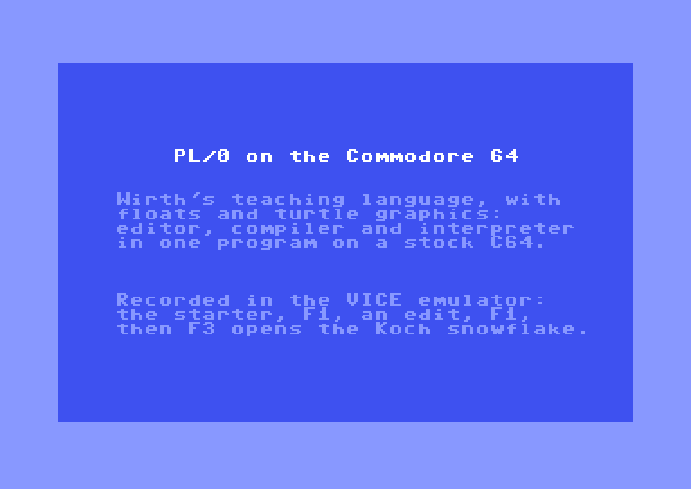

*Recorded in the VICE emulator from the real program. Cursor moves are
played 2x, disk waits 4x and the 26-second snowflake 5x as fast.*

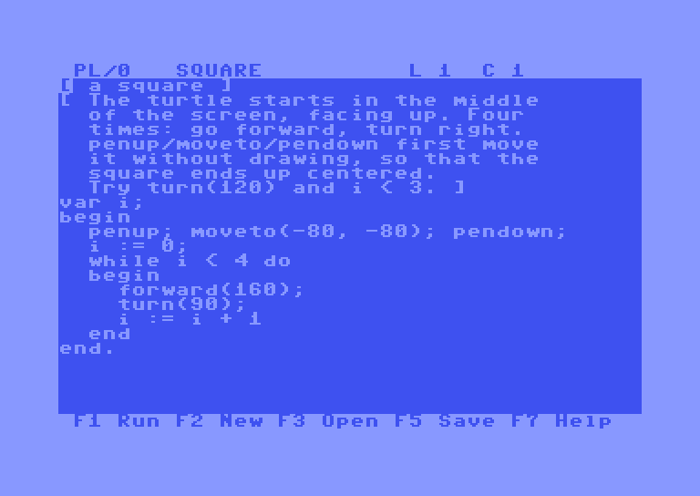 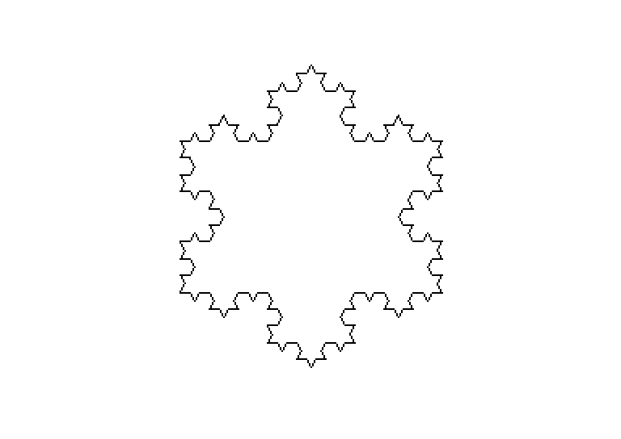
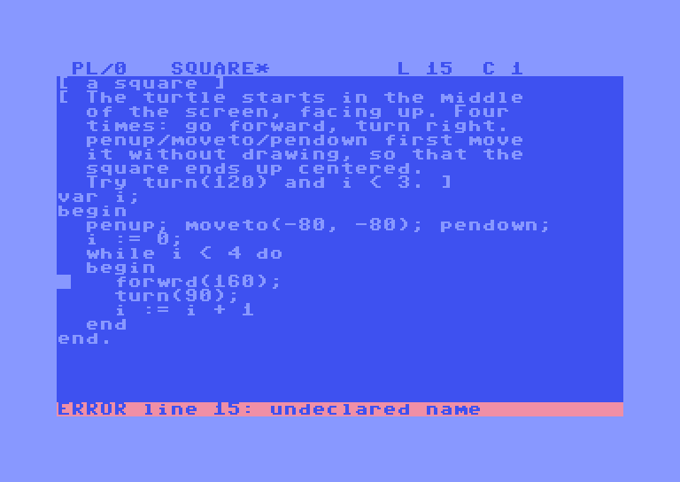 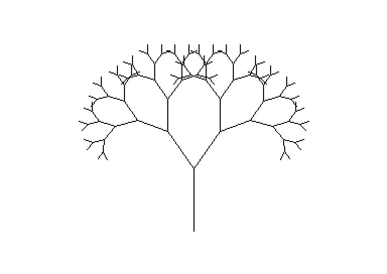

## Try it in two minutes

1. Install [VICE](https://vice-emu.sourceforge.io/), the C64 emulator,
   with its C64 ROMs (the VICE releases include them; on Debian and
   Ubuntu run `sh tools/install_vice_roms.sh` after installing the
   `vice` package).
2. Get `pl0.d64`, the disk with the program and 15 examples. For now,
   build it with `make dist` (it appears in `build/dist/`); that needs
   cc65 2.19 and VICE's `c1541`, see
   [installing the tools](docs/architecture/testing.md#installing-the-tools-ubuntu-2404)
   and [below](#build-and-test). Nothing has been published yet: a
   published release and the showcase site will carry the downloads.
3. Start it:

   ```sh
   x64sc -autostart pl0.d64
   ```

   Loading takes about 80 seconds of emulated time at the real speed of
   a 1541 disk drive; VICE normally runs autostart in warp mode (its
   default `AutostartWarp`), so on a PC the wait is much shorter (under
   20 seconds in the tests, from VICE's start to the drawn square).
4. The editor opens with a program that draws a square. Press **F1**.

| Key | |
|---|---|
| F1 | compile and run |
| F2 | new program |
| F3 | open an example or a saved program |
| F5 | save to the disk |
| F7 | help |
| RUN/STOP (Esc in VICE) | stop a running program |
| SPACE after a drawing | switch between the drawing and the text output; any other key returns to the editor |

The [user guide](docs/USER-GUIDE.md) explains the rest.

## A taste of the language

The fractal tree above is this program, one of the 15 examples. The
procedure `tree` has two parameters and calls itself twice:

```pl0 example:tree
{ fractal tree }
{ A tree is a trunk with two
  smaller trees on top, one turned
  left and one turned right. After
  a branch the turtle goes back
  down with the pen up. Try
  angle = 20, f = 0.6 or depth 5. }
const depth = 7, angle = 35,
  f = 0.72;

procedure tree(len, d);
begin
  forward(len);
  if d > 1 then
  begin
    turn(-angle);
    call tree(len * f, d - 1);
    turn(2 * angle);
    call tree(len * f, d - 1);
    turn(-angle)
  end;
  penup; forward(-len); pendown
end;

begin
  penup; moveto(0, -95); pendown;
  call tree(62, depth)
end.
```

The [language reference](docs/LANGUAGE.md) describes every statement,
function, limit and error message.

## The examples

| | Example | | | Example |
|---|---|---|---|---|
| 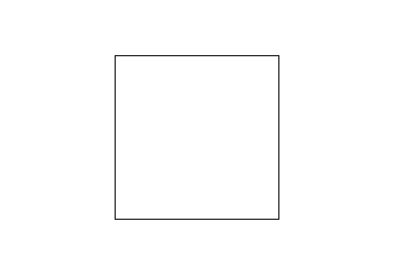 | **SQUARE**<br>a square | | 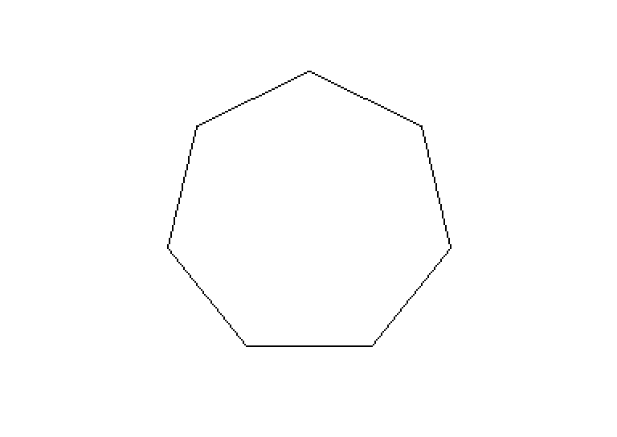 | **POLYGON**<br>regular polygon |
| 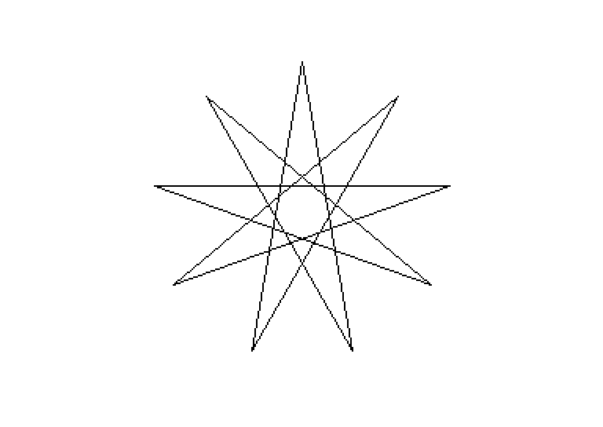 | **STAR**<br>star polygon | | 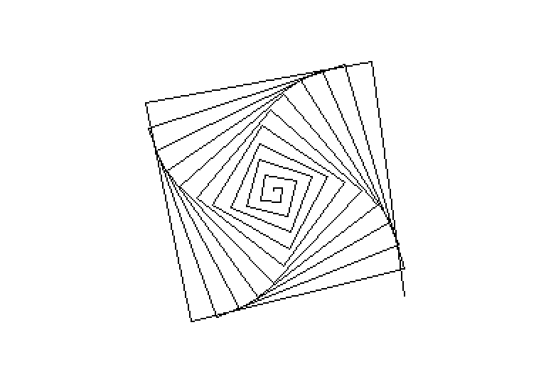 | **SPIRAL**<br>square spiral |
| 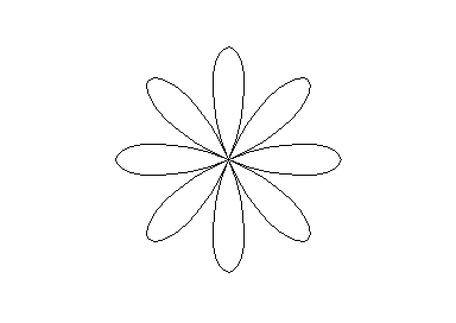 | **ROSE**<br>rose curve | | 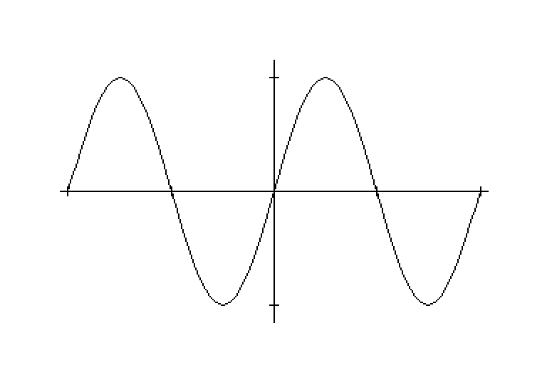 | **SINE**<br>plot of sin(x) |
| 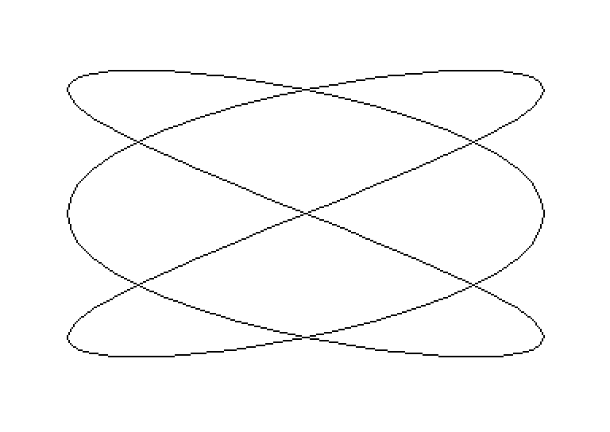 | **LISSAJOUS**<br>Lissajous curve | | 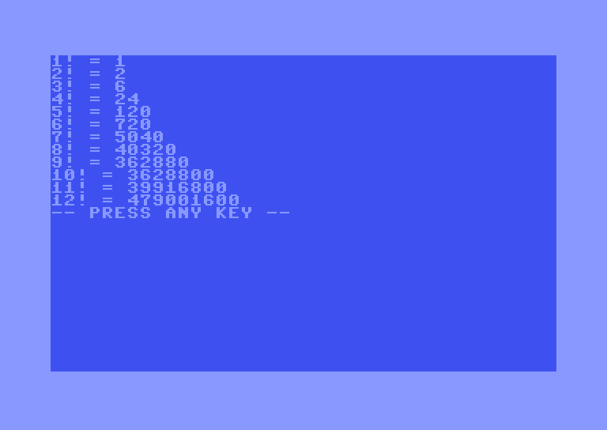 | **FACTORIAL**<br>factorials 1! to 12! |
| 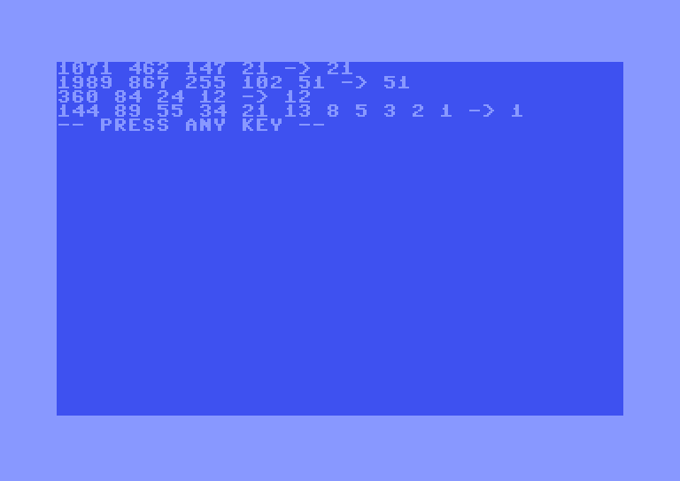 | **GCD**<br>greatest common divisor | | 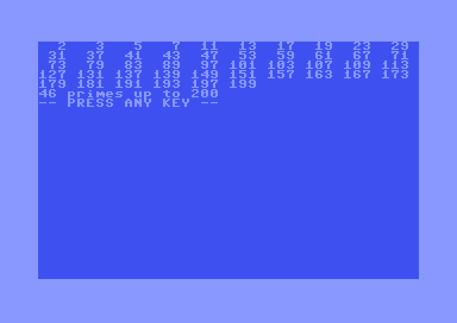 | **PRIMES**<br>prime numbers to 200 |
| 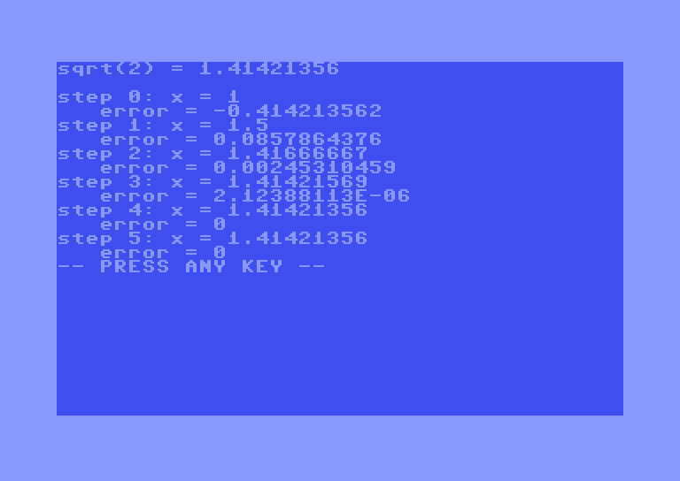 | **NEWTON**<br>square root by Newton | | 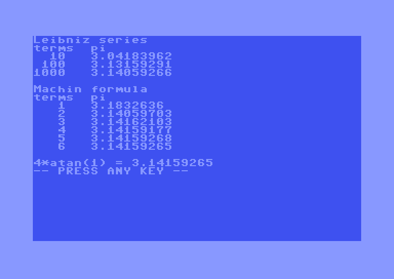 | **PI**<br>pi from two series |
|  | **KOCH**<br>Koch snowflake | | 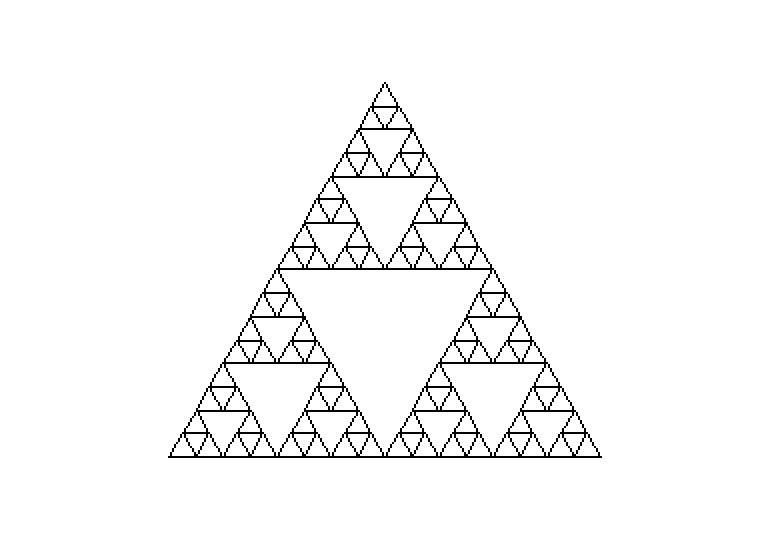 | **SIERPINSKI**<br>Sierpinski triangle |
|  | **TREE**<br>fractal tree | | | |

Each runs in under 30 seconds on a C64, from 1 second (SQUARE) to 26
(KOCH). The [user guide](docs/USER-GUIDE.md#the-examples) has each one's
source and ideas to try.

## What makes it interesting

- **Floating point from the BASIC ROM.** Arithmetic and `sin`, `cos`,
  `atan`, `sqrt`, `exp`, `log` call the C64's own ROM routines through
  small assembly shims that switch the ROM in for one call and trap its
  errors. The ROM's own number printing is wrong in the ninth digit, so
  printing and parsing are exact conversions written in 6502 assembly.
- **Procedures with parameters and recursion,** which Wirth's PL/0 does
  not have, compiled to his P-code and run by a stack machine.
- **Turtle graphics** on the 320 x 200 bitmap, with lines clipped at the
  screen edge by the same code on the C64 and on the PC.
- **A real editor in 40 columns:** status bar, function keys, sideways
  scrolling for long lines, errors that put the cursor on their line,
  a list of programs on the disk, save with replace.
- **It fits in 64 KB.** The program is 30,356 bytes; the 8 KB program
  text lives in the RAM under the BASIC ROM, the 8,000-byte bitmap under
  the KERNAL ROM, and 61 bytes of the main memory are left over
  ([memory map](docs/architecture/memory-map.md)).
- **One core, tested twice.** The compiler and interpreter are portable C
  (cc65 for the C64, gcc on a PC). The PC tests run in seconds; the same
  code then runs in a headless VICE, where every example must produce
  the PC's output or drawing.

## Limits and known issues

- **No emulator in the browser.** The program needs the BASIC ROM's
  float routines; the only open replacement ROMs do not implement them,
  and the original ROMs cannot be redistributed. The showcase site shows
  recordings instead, and you run the program in your own emulator.
- **Small programs.** At most 8,191 characters of text, 768 compiled
  instructions, 64 names in scope, procedures nested 4 deep, recursion
  about 100 to 170 calls deep. The largest example uses 153 instructions.
- **The language is PL/0:** no `else`, no `and`/`or`, no arrays, no
  functions that return values. Numbers have about 9 digits on the C64,
  so results can differ from a PC in the last digits.
- **It is a C64:** a turn costs a ROM sine and cosine, so drawings take
  up to 26 seconds; the first load from the disk takes about 80 seconds
  on a real 1541 (VICE warps through it), and loading an 8 KB program
  about 40 seconds.
- **RESTORE is disabled** while the program runs, so RUN/STOP+RESTORE
  cannot drop you into BASIC and lose the text.
- **No room to grow** without freeing memory first (61 bytes free).
- **Not yet verified:** a real C64 (all tests use VICE); the CI job that
  runs the on-target tests on GitHub and the Pages workflow that
  publishes the showcase site (neither has ever run: no remote
  repository yet).

## How this was built with Superpowers

The project was built with [Superpowers](https://github.com/obra/superpowers),
the skills for Claude Code, as a showcase of the workflow:
brainstorming with the author settled the purpose, the language
extensions and the screen design; a written
[design](docs/superpowers/specs/2026-11-15-pl0-c64-design.md) and a
19-task [plan](docs/superpowers/plans/2026-11-15-pl0-c64.md) followed; a
controller session then ran the plan with subagent-driven development,
a fresh implementer and a reviewer for every task. The reviews caught,
among others, a buffer overflow, a cc65 miscompile that made every
procedure parameter 0 on the C64, and three tests that could pass
without testing anything; a final review of the whole branch found one
more that every task review had missed, a save that could erase the
program from its own disk. [How this was built](docs/HOW-THIS-WAS-BUILT.md)
tells the whole story, with the numbers and what went wrong.

## Documentation

| Document | |
|---|---|
| [User guide](docs/USER-GUIDE.md) | starting, editing, running, saving, the examples, a tutorial |
| [Language reference](docs/LANGUAGE.md) | the grammar, every statement and function, limits, all error messages |
| [Architecture overview](docs/architecture/overview.md) | layers, P-code, memory map, design decisions, tests |
| [How this was built](docs/HOW-THIS-WAS-BUILT.md) | the Superpowers process, with its record in [docs/process](docs/process/README.md) |
| [All documents](docs/README.md) | the index |

## Build and test

Needs gcc, GNU make and Python 3; for the C64 parts also cc65 and VICE
(on Ubuntu 24.04: `sudo apt-get install gcc make python3 cc65 vice`,
then `sh tools/install_vice_roms.sh` for the ROMs). Tested with cc65
2.19 (the Ubuntu 24.04 package `cc65 2.19-1`): the program leaves only
61 bytes of main memory free, so another cc65 version may
produce a bigger program that no longer fits; the link (or `make
c64-mem`) then fails loudly rather than building a broken program.

| Command | What it does | Time |
|---|---|---|
| `make test` | host tests: unit tests, the examples against their goldens, tool self-tests, documentation checks | 10 to 20 s |
| `make check` | `make test`, then the on-target suite in headless VICE | about 4.5 min |
| `make check-full` | `make check`, then every example on the C64 twice, with its time | about 8 min |
| `make dist` | `build/dist/pl0.prg` and `build/dist/pl0.d64`, the disk verified | |
| `make media` | the screenshots and the demo GIF, captured in VICE | several minutes |
| `make web` | the showcase site in `build/site` | |

`build/pl0host FILE.pl0` (after `make host`) runs a PL/0 program on the
PC. Details: [testing](docs/architecture/testing.md).

## Licence

MIT, see [LICENSE](LICENSE). No ROM images or emulator files are
included.
