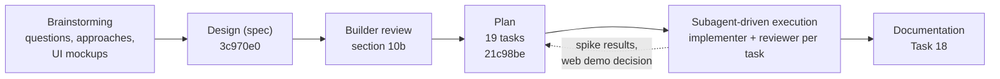

# How this was built

This project was built with [Superpowers](https://github.com/obra/superpowers),
a set of skills for Claude Code that turn a request into a design, the
design into a plan, and the plan into reviewed code. It was also meant as
a showcase of that workflow, so this page tells how it went, with the
numbers, the mistakes the process caught and the places where it was
slow or wrong. Every number here comes from the
[ledger](process/ledger.md), the task reports or the git history.

## The sequence

### 1. Brainstorming

The author started with an idea: Wirth's PL/0 on a Commodore 64. The
brainstorming skill asks one question at a time and proposes options.
The answers that shaped the project:

| Question | Answer | What it changed |
|---|---|---|
| Why build it? | A showcase for Superpowers: colleagues should see the GitHub project, be able to run it, and see how Superpowers was used. | Documentation, user experience and a visible development trail became part of the deliverable, with a "colleague scenario" as the success test (spec section 1). |
| Procedure parameters? | Yes, the author's decision; plain PL/0 has none. | Recursive drawings like the Koch snowflake can pass lengths and depths (spec section 5). |
| How to implement? | Approach A: cc65 C compiling to P-code, chosen over pure 6502 assembly (B) and a C interpreter walking the program text (C). | One portable core, testable on a PC; an early spike to check the memory budget (spec section 4). |
| What should the screen look like? | Mockups were shown in the browser companion; the author chose "editor first, function keys" with an example list on F3, over a start menu. | The editor starts with a program loaded, so the first key can be F1 (spec section 6). |

The result is the design document,
[docs/superpowers/specs/2026-11-15-pl0-c64-design.md](superpowers/specs/2026-11-15-pl0-c64-design.md),
committed as `3c970e0`. It has goals, non-goals and anti-goals (for
example "error messages that need decoding"), the constraints (38 KB of
RAM, cc65, the BASIC ROM for floats), the approaches considered, the
language, the screens, and a list of choices left to the builder.

### 2. The builder review

Before planning, a reviewer read the design as the one who would build
it. Its questions are not in the repository, but the designer's answers
are, as section 10b of the spec: every example is a requirement (if they
do not fit, move the VM to assembly or use the RAM under the ROMs, do
not drop examples); the BASIC ROM must stay visible; the on-target
smoke test is a required gate where VICE exists; the web demo may only
use an emulator and ROMs that can legally be published, otherwise stop
and ask the author; examples must finish in about 30 seconds; source
files are plain ASCII; error messages live in one table that the
language reference is checked against. Several of these became tests:
the 30-second limit, `check_error_docs.py`, and the ROM rule, which
later changed the deliverable.

### 3. The plan

The plan, [docs/superpowers/plans/2026-11-15-pl0-c64.md](superpowers/plans/2026-11-15-pl0-c64.md)
(`21c98be`), has 19 tasks: a skeleton, a throwaway spike, the portable
core in eight test-first steps, the C64 layers, the editor, the run flow
and disk, the build products and gates, the web demo and the
documentation. Each task lists its files, its interfaces and its tests.
It was amended three times, each amendment recorded in the plan itself:
after the spike (`5f14975`, `bbd6935`: the limits, the RAM under the
BASIC ROM, examples on the disk, a step budget 50 times smaller), and
after the web demo decision (`fe2f85b`).

### 4. Execution: subagent-driven development

The plan was carried out with the subagent-driven-development skill. One
session, the controller, never writes product code. For each task it:

1. writes a brief (or, for the larger late tasks, an expanded design),
2. dispatches a fresh implementer subagent, which works test-first and
   commits,
3. dispatches a reviewer subagent, which checks the work against the
   spec and the plan and for quality, and sorts its findings into
   Critical, Important and minor,
4. sends Critical and Important findings back to the implementer as a
   fix round (at most five), then has the fix reviewed again,
5. records everything in the ledger: dispatches, results, fix rounds,
   minor findings deferred to later tasks, and its own rulings.

Before Task 0 the controller scanned the plan for contradictions between
tasks and settled nine of them (the "pre-flight scan" at the top of the
ledger). The work happened in a git worktree on the branch `impl`,
which has 74 commits before this documentation: from the design
(`3c970e0`, 12:12) to the showcase site's last fix (`a5ef336`, 20:48),
all dated 2026-11-15.

### 5. Decisions the author made during execution

The controller stopped and asked the author three times:

- **Install cc65.** The C64 compiler was missing and `sudo` needed a
  password. The controller reordered the plan to do the host-only tasks
  first while the author installed it (ledger, after Task 0).
- **The web demo.** The plan wanted a JavaScript emulator on GitHub
  Pages. The only open replacement ROMs (Open ROMs) mark the float
  routines the program calls (sin, cos, atn, exp, log and others) as not
  done, and the original Commodore ROMs cannot be redistributed with
  clear rights. As the spec required, the controller asked; the author
  chose "no live emulator: recordings and downloads only". Task 17 became
  real VICE captures and a static showcase page (ledger, before Task 17;
  plan amendment `fe2f85b`).
- **The licence holder.** `LICENSE` (MIT) carries the git user name; the
  author has still to confirm it.

## The evidence

### Tasks and reviews

The plan's 19 tasks became 21: the controller inserted Task 10b (a clear
message for strings that are too long) and Task 12b (ASCII on the C64
and the first run of the core on the C64). Up to Task 17 that is 20
tasks, from the ledger:

| | Tasks |
|---|---|
| review clean at the first attempt (11) | 0, 1, 3, 4, 6, 7, 8, 10, 10b, 11, 14 |
| one fix round, then clean (9) | 2, 5, 9, 12, 12b, 13, 15, 16, 17 |
| more than one fix round | none |

The reviews raised 10 Important findings (Task 5: 2, Tasks 9, 12, 12b,
13, 15, 16: 1 each, Task 17: 2) and one failed spec check (Task 2); none
was rated Critical. Smaller findings were recorded as "minor" (30
ledger lines, often several findings each) and deferred; several were
picked up by later tasks, for example the timeout for test programs
(Task 7), the whole-line match of the VICE screen check (Task 12) and
the weak substring match of `check_error_docs.py` (Task 18).

### Defects the process caught

Each of these was a real defect or a gap in a test, found before the
work was accepted. "Review" means the reviewer subagent of that task.

| What was wrong | Found by | Fixed in |
|---|---|---|
| `num_format` could write 17 bytes into the 16-byte buffer for numbers with a 3-digit exponent | Task 2 review (spec check failed) | `dfa7fc3` |
| The compiler's recursion for nested statements had no bound: deep nesting would overflow cc65's small stack on the C64 | Task 5 review (Important) | `c19a5d6` |
| `errors.c` did not compile under cc65 (mixed pointer types in a `?:`) | Task 5 implementer, checked with `cl65` | `661557c` |
| The line clipper had no tests with exact expected values | Task 9 review (Important) | `5fd3ae9` |
| A string of 17 characters was reported as `unterminated string` | controller, reading the Task 10 results | Task 10b, `38e7e87` |
| The ROM's number output and input are wrong in the 9th digit (pi printed as `3.14159266`) | Task 11 implementer, on the C64 | exact conversion in assembly, `18e8e95`, `ade5653` |
| The VICE screen check passed when the expected text was empty | Task 12 review (Important) | `7e426d9` |
| Keywords, error texts and the number format were PETSCII in some modules and ASCII in others | Task 12 implementer's concern; controller ruling | Task 12b, `96cb343` |
| cc65 `-O` computed `(int16_t)i - n` in 8 bits: every procedure parameter read 0 on the C64, while the host was right | Task 12b, the first run of the core on the C64 | `1cd1dce`, reproducer `tests/c64/cc65_bug_sub.c` |
| The C64 drawing check (pixel count and bounding box) would accept a mirrored figure | Task 12b review (Important) | overlap check with a self-test, `fad5ddc` |
| The text buffer's random test parked the gap at the end every step, so it never tested edits in the middle | Task 13 review (Important) | `ce1e61f` |
| Several edits typed quickly were not all redrawn | Task 14, the implementer's own review, proven by a new on-target case | `c31ab80` |
| `DISK ERROR: FILE NOT FOUND` overflowed its message buffer by 3 bytes | Task 15 review (Important) | `dbaff59`, with a compile-time size check |
| The example acceptance script passed with zero examples when a pipeline step failed | Task 16 review (Important); the same pattern found in a second script | `208858f` |
| Every VICE run with a disk waited 20 s to be killed (VICE ignored `quit` after `detach`) | Task 16 implementer | `d2ef44b`: `make c64-app` from about 9 to 2.5 minutes |
| The site checker passed an empty page and had no size limits | Task 17 review (Important) | `a5ef336` |
| No ROMs that may be published can run the program, so a browser demo cannot be legal | controller, preparing Task 17 | author's decision, plan amendment `fe2f85b` |

A pattern is visible: three times (Tasks 12, 16 and 17) a test or
checker could pass without checking anything, and each time the
reviewer found it. Each fix came with a self-test that runs in
`make test` and proves the checker fails when it should.

### The rulings

The controller decided these itself, recorded each in the ledger with
its reason (and often the cost if it was wrong), and went on:

| Ruling | Reason |
|---|---|
| Create the worktree by hand with git | the built-in worktree tool needs the user's own wording |
| Host-only tasks first; provisional limits until the spike | cc65 was not installed yet |
| The program text lives in the RAM under the BASIC ROM | the spike showed it works when the ROM is switched in only during a call; otherwise the text limit drops to 4 KB |
| The limits: 768 instructions, 64 names, 512 stack cells, 4 levels, 8 KB of text, 128 constants, 1 KB of strings | the spike's measurements (section 7) |
| The examples are files on the disk, not data in the program | they did not fit next to the program |
| The step budget for examples is 40,000 instructions, not 2,000,000; the turtle caches sine and cosine | a ROM sine takes 28 ms |
| A runtime error reports the operator's line | accurate and cheap; to be documented (it is, in the language reference) |
| Empty parentheses `()` stay an error | the strict PL/0 spirit; documented |
| `num_add`, `num_sub`, `num_mul` and `num_neg` return an overflow flag | so the VM can report `number overflow` like the C64's ROM trap |
| Insert Task 10b: `string too long (max 16)` | the old message was misleading |
| "ESC" means RUN/STOP | the C64 has no Esc key; VICE maps the PC's Esc to RUN/STOP |
| ASCII inside the whole program, PETSCII only at keyboard, screen and disk; insert Task 12b | the modules disagreed; and the core had never run on the C64 |
| F2 (SHIFT+F1) for a new program; HOME, CLR, DEL, INST as on the C64; one starter program in memory | the C64 has no Ctrl-N, and memory was short |
| Task 15 must first free low RAM (VM stack to HIBSS, unused code out, the list in the idle Program memory) | after Task 14 only 243 bytes were free |

### Key commits

| Commit | Step |
|---|---|
| `3c970e0` | the design |
| `21c98be` | the plan |
| `32ba1c9`, `5f14975` | spike results, plan amendments |
| `6b342eb`, `7f7a1a5`, `4dbbee4` | the core, procedures with parameters, the 15 examples |
| `18e8e95`, `96cb343`, `1cd1dce` | numbers on the BASIC ROM, ASCII on the C64, the core on the C64 |
| `c31ab80`, `874bd94`, `69b3e83` | the editor, freeing memory, run flow and disk |
| `942e31b`, `0a32723` | acceptance tests, `make check` and `make dist` |
| `fe2f85b`, `9c5bd9d`, `999d647` | the web demo decision, the VICE captures, the showcase page |

## What it cost, and what was hard

- **It took a while to learn the machine.** The plan's draft limits did
  not fit (the spike's stub alone overflowed by 7,362 bytes), the plan
  embedded the examples in the program, and its web demo assumed an
  emulator that could be published. All three were wrong, and all three
  were found early, by the spike and by the controller's checks, but
  each cost a plan amendment and rework in later briefs.
- **Memory was tight all the way.** After the editor (Task 14) 243 bytes
  were free; the first full build of Task 15 overflowed by 988 bytes.
  Making room cost a refactoring step and moving code to assembly. The
  program ends with 115 bytes to spare, so any later feature needs
  memory found first.
- **On-target tests are slow.** At Task 15 the on-target gate took 699
  seconds; `make c64-app` alone about 9 minutes, most of it VICE waiting
  20 seconds to be killed. After the fix of Task 16, `make check` takes
  about 4.5 minutes and `make check-full` about 8. The host tests take
  seconds, which is why the core was written to be tested on the host.
- **Nine tasks needed a fix round.** Each was one round, but a round
  means a second implementer pass and a second review. Several fixes
  were to tests and tools rather than to the product: a test that cannot
  fail is easy to write and hard to see.
- **The commit trailers are not what was asked.** The author asked for
  the line `Co-Authored-By: Claude Sonnet 5.5`; 29 of the 74 commits
  before Task 18 carry `Claude Opus 5.5` instead. The ledger notes it as
  a known deviation. The commits of this documentation task carry the
  Opus line too: they were written by Claude Opus 5.5.
- **Some decisions were the controller's, not the author's.** The
  rulings above were made without asking the author. They are all
  recorded with their reasons, so they can be revisited.
- **Not everything is verified.** The CI job that runs the on-target
  suite on GitHub has not run yet (there is no remote repository); the
  ROM download it uses is checked by SHA-256 but untested on a runner.
  The program has not been run on a real C64. GitHub Pages needs one
  manual setting before the site deploys.
- **The cost in tokens and time** was not recorded per task. The commit
  times above are the best measure available.

## Where to look

- The design: [spec](superpowers/specs/2026-11-15-pl0-c64-design.md);
  the plan: [plan](superpowers/plans/2026-11-15-pl0-c64.md).
- The record: [docs/process/](process/README.md), with the
  [ledger](process/ledger.md) and the controller's briefs and designs
  for Tasks 12b and 15 to 18.
- What came out: the [README](../README.md), the
  [user guide](USER-GUIDE.md), the [language reference](LANGUAGE.md) and
  the [architecture overview](architecture/overview.md).
