# User guide

PL/0 for the Commodore 64 is a small programming system in one C64
program: a full-screen editor, a compiler and an interpreter for PL/0, a
little language by Niklaus Wirth, here with floating-point numbers,
procedure parameters, maths functions and turtle graphics. You type or
open a program, press F1, and see numbers or a drawing.

This guide shows how to start it, edit, run and save programs, walks
through the 15 examples on the disk, and ends with a short tutorial and
troubleshooting. The language itself is described in the
[language reference](LANGUAGE.md).

## Contents

- [Starting the program](#starting-the-program)
- [The editor screen](#the-editor-screen)
- [Editing keys](#editing-keys)
- [Running a program](#running-a-program)
- [Errors](#errors)
- [Saving and opening programs](#saving-and-opening-programs)
- [The examples](#the-examples)
- [Your first program in five steps](#your-first-program-in-five-steps)
- [Troubleshooting](#troubleshooting)
- [Tips](#tips)

## Starting the program

You need a C64 emulator with the original C64 ROMs, or a real C64 with a
disk drive. The program is tested on [VICE](https://vice-emu.sourceforge.io/)
(`x64sc` 3.7.1, a PAL C64 with a 1541 drive).

1. **Get the files.** `pl0.d64` is a disk image with the program and the
   15 examples; `pl0.prg` is the program alone. Build them with
   `make dist` (they appear in `build/dist/`; see the
   [README](../README.md#build-and-test)), or download them from the
   project's showcase page.
2. **Install VICE.** The VICE releases from its website include the C64
   ROMs. Some Linux packages (Debian and Ubuntu) leave them out; on those,
   `sh tools/install_vice_roms.sh` fetches the VICE 3.7.1 source release,
   checks the five ROM images against fixed SHA-256 sums and copies them
   to `~/.local/share/vice` (see [testing](architecture/testing.md)).
3. **Start it:**

   ```sh
   x64sc -autostart pl0.d64
   ```

   VICE loads the program from the emulated 1541 at the real speed of a
   C64 disk drive: about 80 seconds until the editor appears. Warp mode
   (Alt+W in VICE) shortens the wait; switch it off again to use the
   program at the C64's real speed.

`x64sc pl0.prg` starts the program without the disk image, so the
examples are not there for F3; everything else works.

The program needs the C64's BASIC ROM, whose floating-point routines it
calls; the open replacement ROMs some emulators ship do not implement
them. On a real C64, write `pl0.d64` to a disk (or use a drive emulator
that takes `.d64` images) and type `LOAD"PL0",8,1` and `RUN`. This has
not been tried on real hardware; a real 1541 is as slow as the emulated
one.

## The editor screen

The editor starts with the SQUARE example loaded, so the first key you
press can be F1.

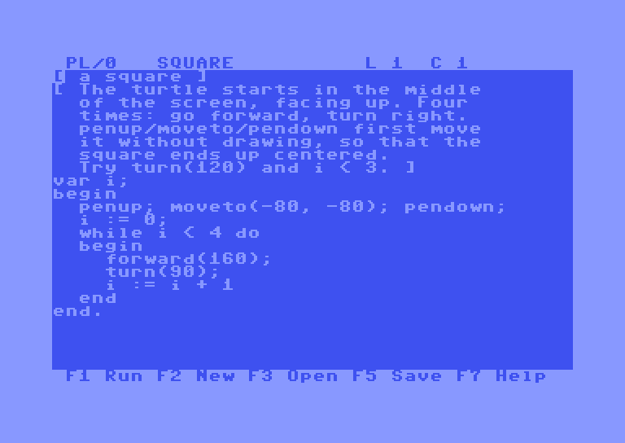

- **Top row: the status bar.** `PL/0`, the program's name (`NEW` for a
  program that was never saved), a `*` when it has changed since it was
  loaded or saved, and the cursor's line (`L`) and column (`C`).
- **Rows 2 to 24: the text.** One program line per row. A line longer than
  the screen scrolls sideways on the cursor's row; other rows show `>` in
  the last column when their line goes on. The comment braces `{ }` show
  as `[ ]`, because the C64's character set has no braces.
- **Bottom row: the key bar,** `F1 Run F2 New F3 Open F5 Save F7 Help`.
  Messages and questions appear here until the next key: errors in red,
  questions in yellow.

F7 shows a help page with the keys and a summary of the language; any
key returns.

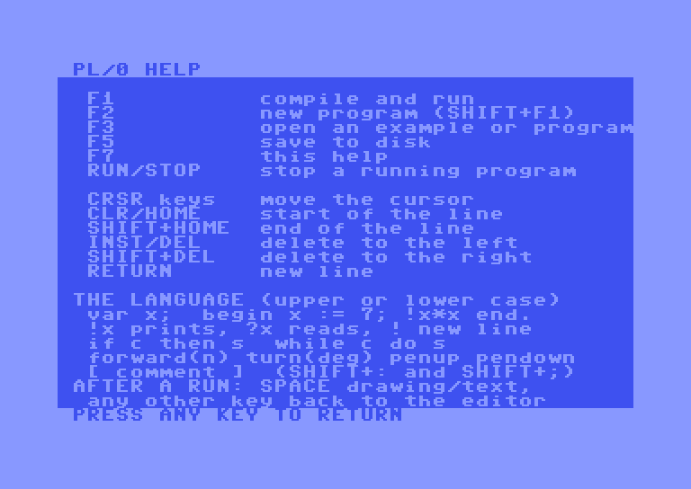

## Editing keys

| Key | Action |
|---|---|
| letters | lower case; with SHIFT upper case (PL/0 ignores case outside strings) |
| digits, punctuation | as printed on the key; SHIFT+SPACE is a space too |
| SHIFT+: and SHIFT+; | `{` and `}`, the comment braces (shown as `[` `]`) |
| RETURN | new line (also SHIFT+RETURN) |
| CRSR keys | move the cursor; up and down keep the column where the vertical move started |
| CLR/HOME | start of the line |
| SHIFT+CLR/HOME | end of the line |
| INST/DEL | delete the character left of the cursor (at the start of a line: join it to the line above) |
| SHIFT+INST/DEL | delete the character under the cursor (at the end of a line: join the next line) |
| F1 | compile and run |
| F2 (SHIFT+F1) | new, empty program; asks `DISCARD PROGRAM? (Y/N)` if the text has changed |
| F3 | open a program or example from the disk (asks the same question first) |
| F5 | save to the disk |
| F7 | help page |

All keys repeat while held. Colour keys, graphics characters and the
other function keys are ignored. Keys pressed while a program is
compiling or running do not reach the editor.

In VICE the PC keyboard stands in for the C64's: Esc is RUN/STOP, Home
is CLR/HOME, Backspace is INST/DEL, Insert is SHIFT+INST/DEL, F1 to F8 are
the function keys (F2 gives SHIFT+F1) and Page Up is RESTORE. These are
the same in VICE's symbolic and positional keyboard mappings (VICE 3.7.1,
`gtk3_sym.vkm` and `gtk3_pos.vkm`). With the symbolic mapping the PC's
`[` and `]` keys type the braces.

## Running a program

Press **F1**. The program is compiled first, which takes a moment for a
long program.

- If the compiler finds an error, you are back in the editor at once,
  with the message on the bottom row and the cursor on the line (see
  [Errors](#errors)).
- Otherwise the screen clears and the program runs. Output from `!`
  appears on the text screen and scrolls when the screen is full.
- The first turtle statement (`forward`, `turn`, `moveto`, `penup`,
  `pendown` or `home`) clears the drawing screen to white and shows it. Output
  printed after that still goes to the text screen, hidden behind the
  drawing.

**RUN/STOP stops a running program** (the error `stopped`). The program
checks the key each time a `while` loop goes round.

When the program ends:

- **Without a drawing:** `-- PRESS ANY KEY --` appears below the output.
  Any key returns to the editor.
- **With a drawing:** the drawing stays on the screen. **SPACE** switches
  between the drawing and the text output, which ends with
  `-- SPACE: DRAWING  ANY KEY: EDITOR --`. Any other key returns to the
  editor.
- **With a runtime error:** the text screen shows the output, then the
  error and `-- PRESS ANY KEY --`; the key returns to the editor with
  the error on the bottom row.

A program that reads a number with `?` shows `? ` and waits for a line
ended by RETURN. If it has drawn something, the question appears on the
text screen, and the drawing comes back with the next line the program
draws.

Running a program never changes its text: back in the editor everything
is as it was, and F1 runs it again.

## Errors

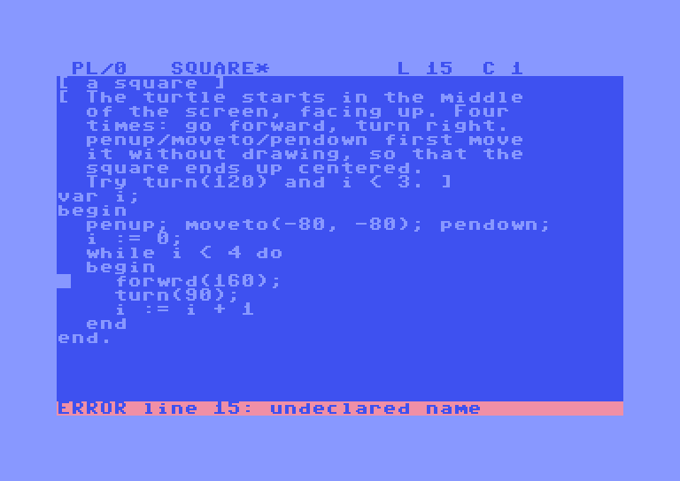

Here `forward` was misspelled as `forwrd` on line 15. F1 came back
with `ERROR line 15: undeclared name` on the bottom row and the cursor on
line 15. The next key clears the message and does its usual job.

Messages are plain English. The [language reference](LANGUAGE.md#errors)
lists every one with an example. Two things help when the line looks
right:

- A compiler error is reported where the compiler noticed it, often the
  start of the next statement: a missing `;` at the end of line 7 shows
  as an error on line 8.
- `undeclared name` usually means a typing mistake, or a procedure that
  is called before it is declared.

## Saving and opening programs

Programs are saved on the disk in drive 8 (or the drive the program was
loaded from) as plain text files.

### Saving (F5)

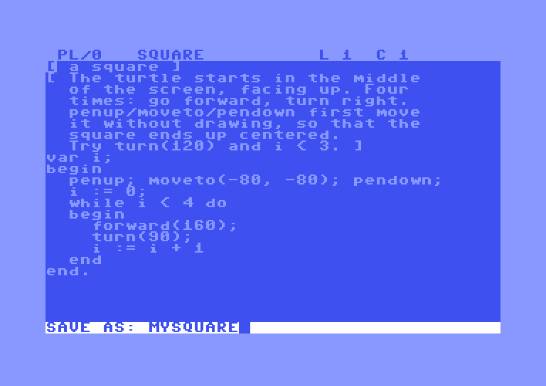

The bottom row shows `SAVE AS:` and the current name. Type a new name
(letters appear in upper case), DEL erases, RETURN saves, RUN/STOP
cancels.

- A name has 1 to 12 characters from `A-Z 0-9 - _ .`, with no
  extension: `MYSQUARE`, not `MYSQUARE.PL0`. Anything else gives
  `BAD NAME` and nothing is written.
- If a file of that name exists, the program asks `REPLACE? (Y/N)`; N or
  RUN/STOP answers `NOT SAVED`.
- After `SAVED MYSQUARE` the program carries the new name and the `*`
  disappears.

Saving under an example's name replaces that example on the disk (after
`REPLACE? (Y/N)`); it keeps its place and description in the list.

### Opening (F3)

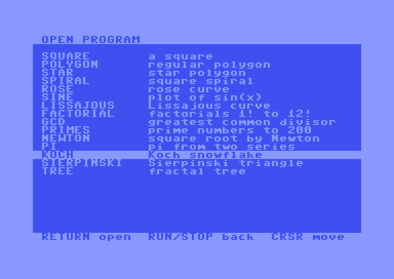

F3 asks `DISCARD PROGRAM? (Y/N)` if your text has changed, then reads
the disk (`READING DISK...`) and lists the examples, in the order of the
disk's `INDEX` file and with their descriptions, followed by your own
programs in alphabetical order. CRSR down and up move the bar, RETURN
opens the program, RUN/STOP goes back with nothing changed.

Loading an example takes a few seconds. A full 8 KB program takes about
40 seconds on a real 1541 (the file is read twice: once to check that it
fits, once to load it).

### What is on the disk

| File | Type | Content |
|---|---|---|
| `PL0` | PRG | the program (120 blocks) |
| `INDEX` | SEQ | one line per example: name and description |
| `SQUARE` ... `TREE` | SEQ | the 15 examples as text |

The rest, 502 blocks, is free for your programs.

### Programs on a PC

Programs are stored as plain ASCII text with one line feed per line, so
a PC can read and write them with `c1541`, which comes with VICE. Give
the file names to `c1541` in lower case: it turns them into the upper
case names the C64 uses.

```sh
c1541 pl0.d64 -list                              # what is on the disk
c1541 pl0.d64 -read mysquare,s mysquare.pl0      # from the disk to the PC
c1541 pl0.d64 -write myprog.pl0 myprog,s         # from the PC to the disk
```

A file written this way shows up in the F3 list if its name follows the
naming rules above. When it is loaded, CR or CR LF line ends become line
feeds, tabs become spaces, and characters outside printable ASCII are
dropped. A file larger than 8,191 characters does not load
(`FILE TOO BIG`). You can also try programs on the PC with the host
driver: `make host`, then `build/pl0host myprog.pl0` prints the output
(a drawing goes to a picture with `--pbm out.pbm`).

## The examples

The disk holds 15 examples, in the order of the F3 list: simple drawings
first, then programs that print, then recursion. Every picture is the C64
screen at the end of the run, captured in VICE. The times are measured on
the emulated C64 from F1 to the end of the program
([examples budget](architecture/examples-budget.md)); every example
finishes in under 30 seconds.

Each example starts with comments that explain it and suggest something
to change. Open it with F3, change a number, and press F1 again.

### SQUARE: a square

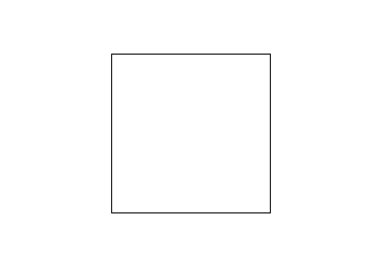

The starter program, already loaded when the editor starts. The turtle lifts its pen, moves to the lower left corner with `moveto`, puts the pen down, and then four times goes forward 160 pixels and turns 90 degrees to the right. It runs for 1.1 s on the C64.

Try: Change `turn(90)` to `turn(120)` and `i < 4` to `i < 3`: a triangle (the demo GIF does exactly this).

<details>
<summary>Source of SQUARE</summary>

```pl0 example:square
{ a square }
{ The turtle starts in the middle
  of the screen, facing up. Four
  times: go forward, turn right.
  penup/moveto/pendown first move
  it without drawing, so that the
  square ends up centered.
  Try turn(120) and i < 3. }
var i;
begin
  penup; moveto(-80, -80); pendown;
  i := 0;
  while i < 4 do
  begin
    forward(160);
    turn(90);
    i := i + 1
  end
end.
```

</details>

### POLYGON: regular polygon

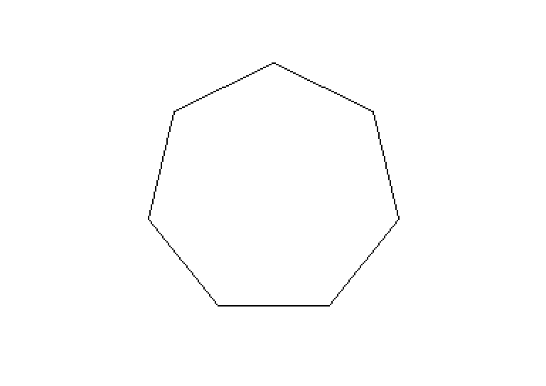

A regular polygon with `n = 7` sides. The side length comes from `sin`, so that every polygon fits the same circle of radius 90, and the turtle turns 360/n degrees at each corner. It runs for 2.0 s on the C64.

Try: `n = 3`, `5`, `12` or `40`. With 40 sides it is nearly a circle.

<details>
<summary>Source of POLYGON</summary>

```pl0 example:polygon
{ regular polygon }
{ n equal sides, and the turtle
  turns 360/n degrees at each
  corner, 360 in total. The side
  is computed so that every
  polygon fits a circle of radius
  r. Try n = 3, 5, 12 or 40. }
const n = 7, r = 90, pi = 3.14159265;
var s, i;
begin
  s := 2 * r * sin(pi / n);
  penup;
  moveto(-s / 2, -r * cos(pi / n));
  turn(90);
  pendown;
  i := 0;
  while i < n do
  begin
    forward(s);
    turn(-360 / n);
    i := i + 1
  end
end.
```

</details>

### STAR: star polygon

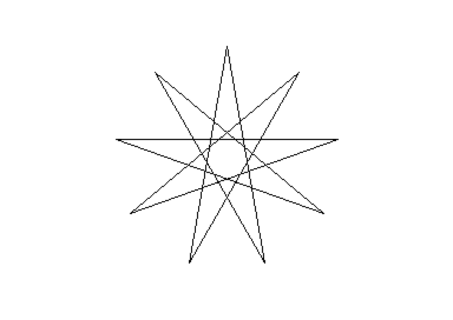

A star polygon: 9 points on a circle, each joined to the 4th one after it. The turtle turns 360*k/n degrees at each point, and after n lines it has turned round k times. It runs for 2.4 s on the C64.

Try: `n = 5, k = 2` (the five-pointed star) or `n = 36, k = 17`. n and k must have no common divisor, or the line closes early.

<details>
<summary>Source of STAR</summary>

```pl0 example:star
{ star polygon }
{ Join every k-th of n points on a
  circle. The turtle turns 360*k/n
  degrees at each point; after n
  lines it has turned round k times
  and is back at the start.
  Try n = 5, k = 2 or n = 36, k = 17
  (n and k without common divisor) }
const n = 9, k = 4, r = 95,
  pi = 3.14159265;
var s, i;
begin
  s := 2 * r * sin(pi * k / n);
  penup; moveto(0, r);
  turn(90 + 180 * k / n);
  pendown;
  i := 0;
  while i < n do
  begin
    forward(s);
    turn(360 * k / n);
    i := i + 1
  end
end.
```

</details>

### SPIRAL: square spiral

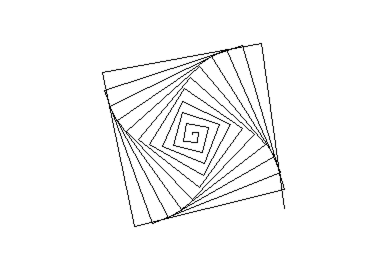

A square spiral: every side is 4 pixels longer than the one before, and the turtle turns 92 degrees instead of 90, so the squares slowly twist. It runs for 5.4 s on the C64.

Try: `angle = 90`, `89` or `121`, or `step = 2`.

<details>
<summary>Source of SPIRAL</summary>

```pl0 example:spiral
{ square spiral }
{ Like a square, but every side is
  a bit longer than the one before,
  and the turtle turns 92 degrees
  instead of 90, so the squares
  slowly twist. Try 90, 89 or 121
  as angle, or step = 2. }
const angle = 92, step = 4;
var len;
begin
  len := 2;
  while len < 170 do
  begin
    forward(len);
    turn(angle);
    len := len + step
  end
end.
```

</details>

### ROSE: rose curve

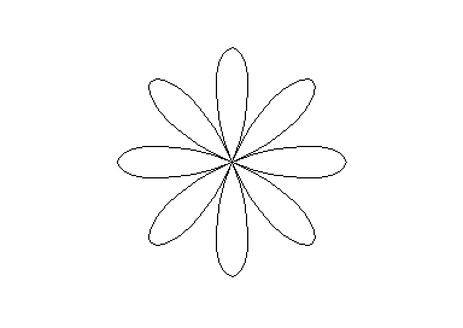

A rose curve in polar coordinates: the point at angle t lies at distance 95*cos(k*t) from the middle. With `k = 4` it has 8 petals (2k for even k, k for odd k). It is drawn with `moveto` only; the pen goes down after the first point. 145 points with three `sin`/`cos` calls each make it one of the slower examples. It runs for 22.1 s on the C64.

Try: `k = 3`, `5` or `6`.

<details>
<summary>Source of ROSE</summary>

```pl0 example:rose
{ rose curve }
{ A point at angle t and distance
  r = 95*cos(k*t) from the middle
  (polar coordinates) draws a rose
  with 2k petals for even k and
  k petals for odd k.
  Try k = 3, 5 or 6. }
const k = 4, steps = 144,
  pi = 3.14159265;
var t, r, i;
begin
  penup;
  i := 0;
  while i <= steps do
  begin
    t := 2 * pi * i / steps;
    r := 95 * cos(k * t);
    moveto(r * cos(t), r * sin(t));
    pendown;
    i := i + 1
  end
end.
```

</details>

### SINE: plot of sin(x)

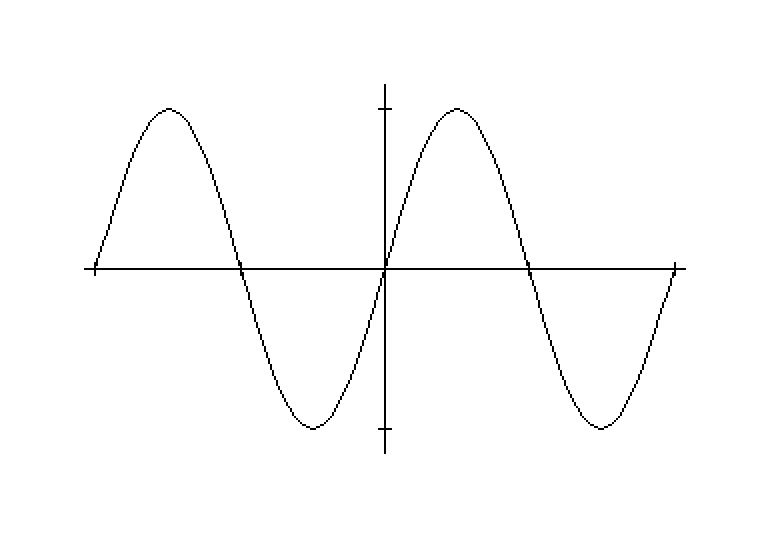

A plot of sin(x) for x from -2*pi to 2*pi, with axes and tick marks. The axes are drawn by a procedure with four parameters, `tick(x, y, dx, dy)`, the curve by `moveto` from point to point. It runs for 9.3 s on the C64.

Try: `cos(x)` or `sin(2*x)` in the `moveto` line.

<details>
<summary>Source of SINE</summary>

```pl0 example:sine
{ plot of sin(x) }
{ x runs from -2*pi to 2*pi. Each
  point is scaled to the screen:
  sx pixels per unit along x and
  80 pixels per unit along y. The
  first moveto has the pen up, the
  others draw a line to each point.
  Try cos(x) or sin(2*x). }
const pi = 3.14159265, sx = 23;
var i, x;

procedure tick(x, y, dx, dy);
begin
  penup; moveto(x - dx, y - dy);
  pendown; moveto(x + dx, y + dy)
end;

begin
  { axes with ticks at pi and 1 }
  call tick(0, 0, 150, 0);
  call tick(0, 0, 0, 92);
  call tick(-2*pi*sx, 0, 0, 3);
  call tick(-pi*sx, 0, 0, 3);
  call tick(pi*sx, 0, 0, 3);
  call tick(2*pi*sx, 0, 0, 3);
  call tick(0, 80, 3, 0);
  call tick(0, -80, 3, 0);
  { the curve }
  i := -48; penup;
  while i <= 48 do
  begin
    x := i * pi / 24;
    moveto(x * sx, 80 * sin(x));
    pendown;
    i := i + 1
  end
end.
```

</details>

### LISSAJOUS: Lissajous curve

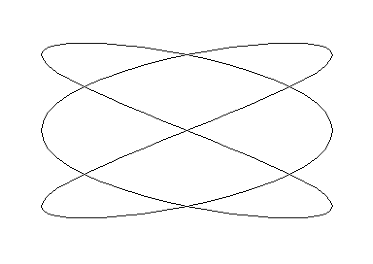

A Lissajous figure: x and y swing like two pendulums, x = 150*sin(3t) and y = 90*sin(2t), while t goes once round from 0 to 2*pi. It runs for 14.5 s on the C64.

Try: `a = 3, b = 4` or `a = 5, b = 4`.

<details>
<summary>Source of LISSAJOUS</summary>

```pl0 example:lissajous
{ Lissajous curve }
{ x and y swing like two pendulums
  with frequencies a and b:
  x = 150*sin(a*t), y = 90*sin(b*t),
  and t goes from 0 to 2*pi.
  Try a = 3, b = 4 or a = 5, b = 4. }
const a = 3, b = 2, steps = 120,
  pi = 3.14159265;
var t, i;
begin
  i := 0;
  while i < steps do
  begin
    i := i + 1;
    t := 2 * pi * i / steps;
    moveto(150*sin(a*t), 90*sin(b*t))
  end
end.
```

</details>

### FACTORIAL: factorials 1! to 12!

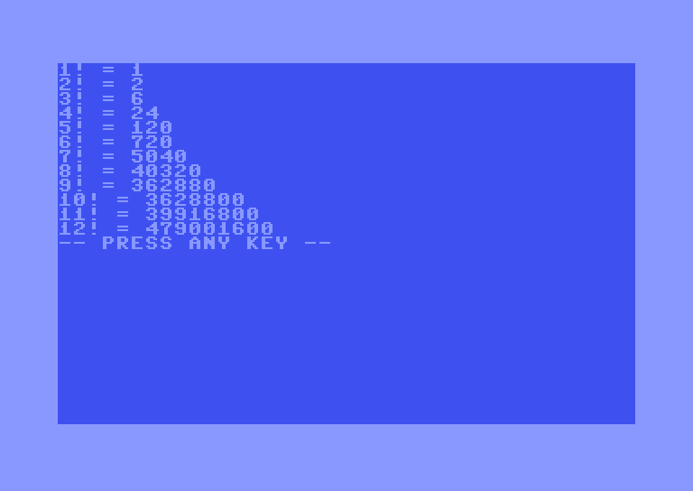

Factorials from 1! to 12! with a recursive procedure: `fact(k)` calls `fact(k - 1)` until it reaches 0! = 1. A procedure cannot return a value, so the result comes back in the global variable `f`. It runs for 3.3 s on the C64.

Try: Change 12 to 20. From 13! on the numbers have 10 digits or more and print in exponent form: `13! = 6.2270208E+09`.

<details>
<summary>Source of FACTORIAL</summary>

```pl0 example:factorial
{ factorials 1! to 12! }
{ n! = 1*2*...*n. fact(k) calls
  itself with k-1 until it reaches
  0! = 1 (recursion). The result
  comes back in the variable f.
  Try 20 instead of 12: from 13!
  on the numbers print as 1.2E+10. }
var n, f;

procedure fact(k);
begin
  if k = 0 then f := 1;
  if k > 0 then
  begin
    call fact(k - 1);
    f := f * k
  end
end;

begin
  n := 1;
  while n <= 12 do
  begin
    call fact(n);
    !n; !'! = '; !f; !;
    n := n + 1
  end
end.
```

</details>

### GCD: greatest common divisor

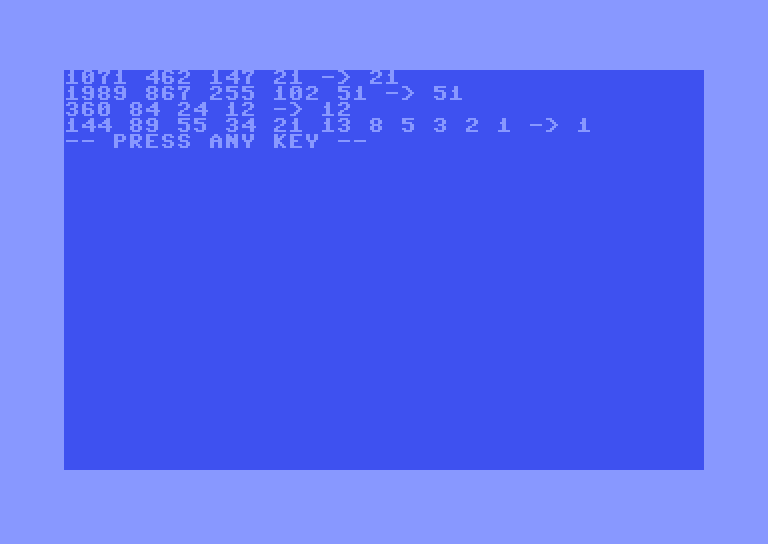

The greatest common divisor by Euclid's method, recursive: gcd(a, b) = gcd(b, r) with r the remainder of a/b, until r is 0. There is no remainder operator, so r is `a - int(a / b) * b`. Each line shows the chain of remainders; consecutive Fibonacci numbers (144, 89) take the most steps. It runs for 2.2 s on the C64.

Try: Add `call show(1000, 625)`.

<details>
<summary>Source of GCD</summary>

```pl0 example:gcd
{ greatest common divisor }
{ Euclid: gcd(a, b) = gcd(b, r),
  r = remainder of a/b, until r
  is 0. Each number printed is the
  remainder of the two before it.
  Fibonacci numbers are the
  slowest case. Try 1000, 625. }
var g;

procedure gcd(a, b);
begin
  !a; !' ';
  if b = 0 then g := a;
  if b > 0 then
    call gcd(b, a - int(a / b) * b)
end;

procedure show(a, b);
begin
  call gcd(a, b);
  !'-> '; !g; !
end;

begin
  call show(1071, 462);
  call show(1989, 867);
  call show(360, 84);
  call show(144, 89)
end.
```

</details>

### PRIMES: prime numbers to 200

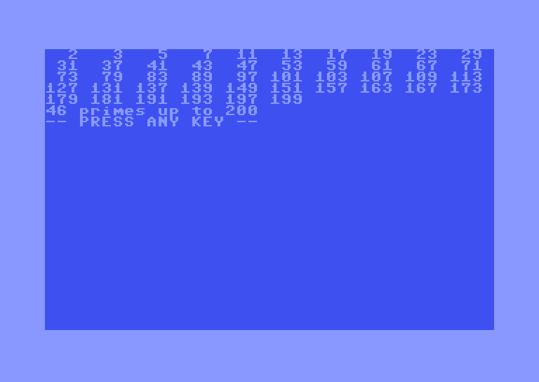

The prime numbers up to 200 by trial division: only odd numbers and odd divisors are tried, a divisor is found when `int(n/d) = n/d`, and the search stops at the first one. A procedure prints the numbers in columns of 10. It runs for 13.7 s on the C64.

Try: `max = 500` (it takes longer).

<details>
<summary>Source of PRIMES</summary>

```pl0 example:primes
{ prime numbers to 200 }
{ n is prime if no d with d*d <= n
  divides it. d divides n when n/d
  is a whole number: int(n/d) = n/d.
  Only odd n and d are tried, and
  the search stops at a divisor.
  Try max = 500 (it takes longer). }
const max = 200;
var n, d, p, c, k;

procedure show(x);
begin
  if c = 10 then begin !; c := 0 end;
  if c > 0 then !' ';
  if x < 100 then !' ';
  if x < 10 then !' ';
  !x;
  c := c + 1; k := k + 1
end;

begin
  call show(2);
  n := 3;
  while n <= max do
  begin
    p := 1; d := 3;
    while d * d <= n do
    begin
      if int(n/d) = n/d then
      begin p := 0; d := n end;
      d := d + 2
    end;
    if p = 1 then call show(n);
    n := n + 2
  end;
  !; !k; !' primes up to '; !max; !
end.
```

</details>

### NEWTON: square root by Newton

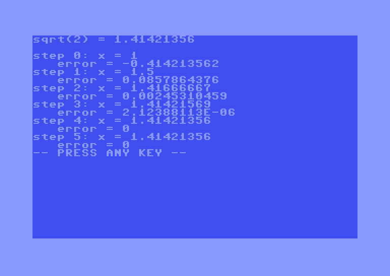

The square root of 2 by Newton's method: replace the guess x by the average of x and 2/x. The error shrinks to about its square in every step, until the computer runs out of digits. On the C64 the last two errors print as 0; on a PC, with more digits, they do not (see [Numbers](LANGUAGE.md#numbers)). It runs for 1.4 s on the C64.

Try: `a = 10` or `a = 1000`.

<details>
<summary>Source of NEWTON</summary>

```pl0 example:newton
{ square root by Newton }
{ Start with a guess x and replace
  it by the average of x and a/x.
  The number of correct digits
  about doubles in every step,
  until the computer runs out of
  digits. Try a = 10 or a = 1000. }
const a = 2;
var x, r, i;
begin
  r := sqrt(a);
  !'sqrt('; !a; !') = '; !r; !; !;
  x := 1; i := 0;
  while i <= 5 do
  begin
    !'step '; !i; !': x = '; !x; !;
    !'   error = '; !x - r; !;
    x := (x + a/x) / 2;
    i := i + 1
  end
end.
```

</details>

### PI: pi from two series

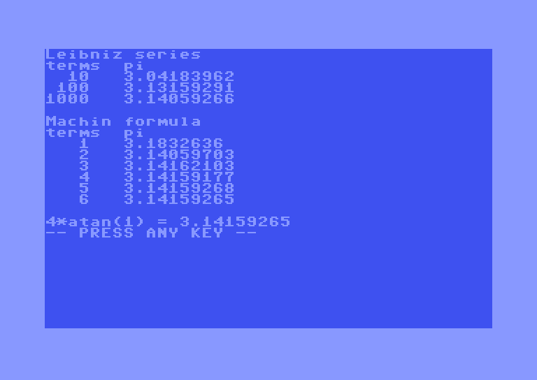

Pi from two series. Leibniz's 1 - 1/3 + 1/5 - ... is simple but slow: 1000 terms give three correct digits. Machin's formula, 16*atan(1/5) - 4*atan(1/239) with the series for atan, has nine digits after 6 terms. The program ends with `4 * atan(1)` from the ROM. The 500 rounds of the Leibniz loop do most of the work. It runs for 24.4 s on the C64.

Try: Fewer Machin terms (`i < 3`), or compare `4 * atan(1)` with your own approximation.

<details>
<summary>Source of PI</summary>

```pl0 example:pi
{ pi from two series }
{ Leibniz: pi/4 = 1-1/3+1/5-1/7...
  is simple but slow: 1000 terms
  give 3 digits. Machin: pi/4 =
  4*atan(1/5) - atan(1/239), with
  atan(x) = x-x^3/3+x^5/5-..., is
  fast: 7 digits in 5 terms. }
var s, i, m, a, b, p, q, t;
begin
  !'Leibniz series'; !;
  !'terms  pi'; !;
  s := 0; i := 0; m := 5;
  while i < 500 do
  begin
    s := s + 1/(4*i+1) - 1/(4*i+3);
    i := i + 1;
    if i = m then
    begin
      if i < 50 then !' ';
      if i < 500 then !' ';
      !2*i; !'   '; !4*s; !;
      m := m * 10
    end
  end;
  !; !'Machin formula'; !;
  !'terms  pi'; !;
  a := 0; b := 0; i := 0; t := 1;
  p := 1/5; q := 1/239;
  while i < 6 do
  begin
    a := a + t * p / (2*i+1);
    b := b + t * q / (2*i+1);
    p := p / 25; q := q / 57121;
    t := -t; i := i + 1;
    !'   '; !i; !'   ';
    !16*a - 4*b; !
  end;
  !; !'4*atan(1) = '; !4 * atan(1); !
end.
```

</details>

### KOCH: Koch snowflake

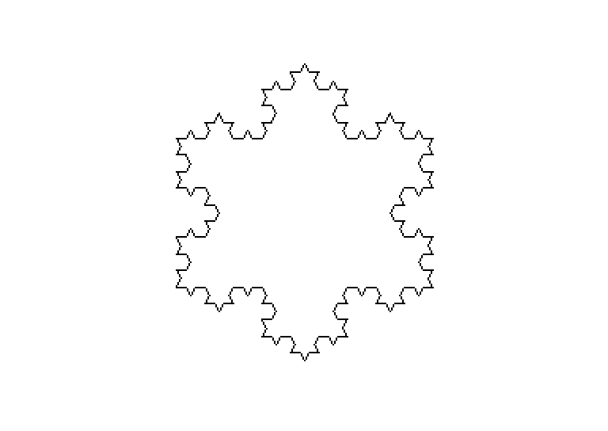

The Koch snowflake: each side of depth d is four sides of depth d-1, a third as long, with a bump in the middle. The recursive procedure `koch(len, depth)` has two parameters, whose names hide the constants `len` and `depth` inside it. Depth 3 gives 192 lines. At 26 seconds it is the slowest example, because every bump needs turns, and every turn a sine and a cosine. It runs for 26.2 s on the C64.

Try: `depth = 1` or `2`; `4` draws four times as many lines and takes much longer.

<details>
<summary>Source of KOCH</summary>

```pl0 example:koch
{ Koch snowflake }
{ A side of depth d is four sides
  of depth d-1, a third as long,
  with a bump in the middle. Depth
  0 is a straight line. Three
  sides make the snowflake.
  Try depth 1, 2 or 4 (slow). }
const depth = 3, len = 162;
var i;

procedure koch(len, depth);
begin
  if depth = 0 then forward(len);
  if depth > 0 then
  begin
    call koch(len / 3, depth - 1);
    turn(-60);
    call koch(len / 3, depth - 1);
    turn(120);
    call koch(len / 3, depth - 1);
    turn(-60);
    call koch(len / 3, depth - 1)
  end
end;

begin
  penup; moveto(-len / 2, 47);
  turn(90); pendown;
  i := 0;
  while i < 3 do
  begin
    call koch(len, depth);
    turn(120);
    i := i + 1
  end
end.
```

</details>

### SIERPINSKI: Sierpinski triangle

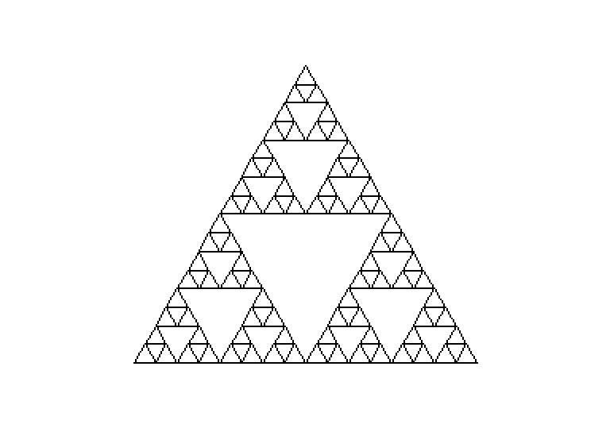

The Sierpinski triangle: a triangle is three half-size triangles, down to depth 4 (243 lines). The procedure `tri(x, y, s, d)` has four parameters and computes the corners itself; the turtle never turns, it only uses `moveto`. It runs for 10.5 s on the C64.

Try: `depth = 2`, or `5` (slower).

<details>
<summary>Source of SIERPINSKI</summary>

```pl0 example:sierpinski
{ Sierpinski triangle }
{ The triangle is three half-size
  copies of itself, and so on.
  At depth 0 one triangle is drawn
  with moveto: its corners are
  computed, the turtle never turns.
  Try depth 2 or 5 (slower). }
const depth = 4, h = 0.8660254;

procedure tri(x, y, s, d);
begin
  if d = 0 then
  begin
    penup; moveto(x, y); pendown;
    moveto(x + s, y);
    moveto(x + s / 2, y + s * h);
    moveto(x, y)
  end;
  if d > 0 then
  begin
    s := s / 2; d := d - 1;
    call tri(x, y, s, d);
    call tri(x + s, y, s, d);
    call tri(x + s/2, y + s*h, s, d)
  end
end;

call tri(-108, -94, 216, depth).
```

</details>

### TREE: fractal tree

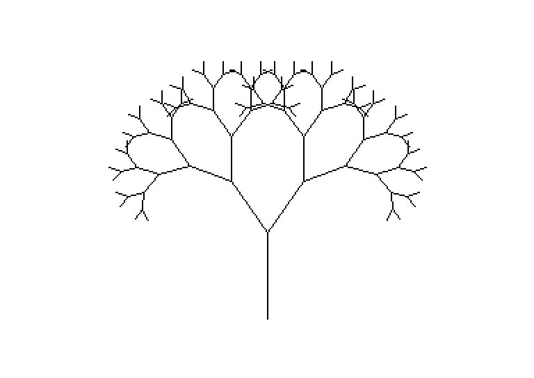

A fractal tree: a trunk with two smaller trees on top, one turned left and one right, 7 levels deep (127 branches). After each branch the turtle goes back down with the pen up, `forward(-len)`, so the procedure leaves it where it started. It runs for 22.1 s on the C64.

Try: `angle = 20`, `f = 0.6` or `depth = 5`.

<details>
<summary>Source of TREE</summary>

```pl0 example:tree
{ fractal tree }
{ A tree is a trunk with two
  smaller trees on top, one turned
  left and one turned right. After
  a branch the turtle goes back
  down with the pen up. Try
  angle = 20, f = 0.6 or depth 5. }
const depth = 7, angle = 35,
  f = 0.72;

procedure tree(len, d);
begin
  forward(len);
  if d > 1 then
  begin
    turn(-angle);
    call tree(len * f, d - 1);
    turn(2 * angle);
    call tree(len * f, d - 1);
    turn(-angle)
  end;
  penup; forward(-len); pendown
end;

begin
  penup; moveto(0, -95); pendown;
  call tree(62, depth)
end.
```

</details>

## Your first program in five steps

Press F2 for an empty program and type along. Each step is a complete
program; press F1 to run it.

**1. Variables and output.** Declare variables with `var`, give them
values with `:=`, print with `!`. A program ends with a full stop.

```pl0 run
var a, b;
begin
  a := 6; b := 7;
  !'6 times 7 is '; !a * b; !
end.
```

```output
6 times 7 is 42
```

`!` prints exactly what you give it; the bare `!` at the end starts a new
line.

**2. A loop.** `while` repeats a statement while a condition holds;
`begin ... end` makes several statements into one.

```pl0 run
var i;
begin
  i := 1;
  while i <= 5 do
  begin
    !i; !' '; !i * i; !;
    i := i + 1
  end
end.
```

```output
1 1
2 4
3 9
4 16
5 25
```

**3. A procedure with a parameter.** A procedure is a named piece of
program. Its parameters get the values of the call.

```pl0 run
procedure stars(n);
begin
  while n > 0 do
  begin
    !'*';
    n := n - 1
  end;
  !
end;

begin
  call stars(1);
  call stars(3);
  call stars(5)
end.
```

```output
*
***
*****
```

**4. A drawing.** The turtle starts in the middle of the screen, facing
up, with its pen down. Here a procedure draws a square of any size, and
the main program draws six of them, turning between them.

```pl0 run
var i;

procedure square(size);
var k;
begin
  k := 0;
  while k < 4 do
  begin
    forward(size);
    turn(90);
    k := k + 1
  end
end;

begin
  i := 0;
  while i < 6 do
  begin
    call square(70);
    turn(60);
    i := i + 1
  end
end.
```

When the drawing is done, SPACE shows the text screen and any other key
returns to the editor.

**5. Some maths.** Numbers can have fractions, and the maths functions
work in radians. This prints the sine of 0, 30, 60 and 90 degrees:

```pl0 run
var d, pi;
begin
  pi := 4 * atan(1);
  d := 0;
  while d <= 90 do
  begin
    !d; !' '; !sin(d * pi / 180); !;
    d := d + 30
  end
end.
```

```output
0 0
30 0.5
60 0.866025404
90 1
```

From here, the examples are the best next step: each one is short and
ends with a suggestion to try. The [language reference](LANGUAGE.md)
has every statement and function.

## Troubleshooting

**Nothing happens after starting VICE.** The program is loading from the
emulated disk drive, which takes about 80 seconds, as on a real C64. Use
warp mode (Alt+W) to wait less.

**F1 shows an error I don't understand.** Look at the line before the
one shown too, and see the list of messages with examples in the
[language reference](LANGUAGE.md#errors).

**The program runs but nothing appears.** A drawing needs the pen down
(`pendown` after a `penup`), and points inside x -160..159, y -100..99;
lines outside the screen are cut off. Text needs `!`.

**It never ends.** Press RUN/STOP. A `while` loop whose condition never
becomes false runs forever; check that its variable changes in the loop.

**Drawing is slow.** The C64 computes a sine and a cosine with the BASIC
ROM for every `turn` (about 56 ms together), and every maths function
call costs tens of milliseconds. The slowest example, KOCH, takes 26
seconds. VICE's warp mode (Alt+W) runs everything faster.

**Messages on the bottom row:**

| Message | Meaning |
|---|---|
| `BUFFER FULL` | the text has reached 8,191 characters |
| `BAD NAME` | the save name is empty, longer than 12 characters or has a character outside `A-Z 0-9 - _ .` |
| `NOT SAVED` | you answered N to `REPLACE? (Y/N)` |
| `NO DISK`, `DISK ERROR: NO DISK` | no drive, no disk in the drive, or the drive is not ready |
| `NO PROGRAMS` | the disk has no programs to list |
| `FILE TOO BIG` | the file has more than 8,191 characters; nothing was loaded |
| `DISK ERROR: FILE NOT FOUND` | the file is not on the disk (for example, deleted with `c1541`) |
| `DISK ERROR: FILE EXISTS` | a file of that name is already on the disk |
| `DISK ERROR: DISK FULL` | no room left on the disk |
| `DISK ERROR: READ FAILED` | the drive did not deliver the whole file |
| `DISK ERROR nn` | another error of the disk drive, with its DOS error number |

If a load fails part way through, the editor keeps what was read, names
it `NEW` and marks it changed, so that you do not save it over the good
file by mistake. If a load fails before anything was read, your text is
untouched.

**RUN/STOP and RESTORE together leave the program.** This is the C64's
reset to BASIC; running the program again starts with the SQUARE example
and the text you were editing is lost. Save often.

**A saved program is missing after quitting VICE.** VICE keeps the last
disk changes in its drive emulation and writes them to the `.d64` file
when the disk is detached; detach the disk (File menu) before you quit to
be sure.

## Tips

- Case does not matter: `BEGIN`, `begin` and `Begin` are the same word.
- Comments go in braces, `{ like this }`, typed with SHIFT+: and
  SHIFT+;, and can span lines.
- Keep lines to 38 characters and they fit the screen without scrolling
  sideways (the examples do).
- Names can have up to 16 characters, strings up to 16; split longer text
  over two `!` statements.
- Use constants for the numbers you want to experiment with, as the
  examples do (`const depth = 3;`), so a change is one edit at the top.
- Procedures can only return results through variables declared outside
  them, as in FACTORIAL (`f`) and GCD (`g`).
