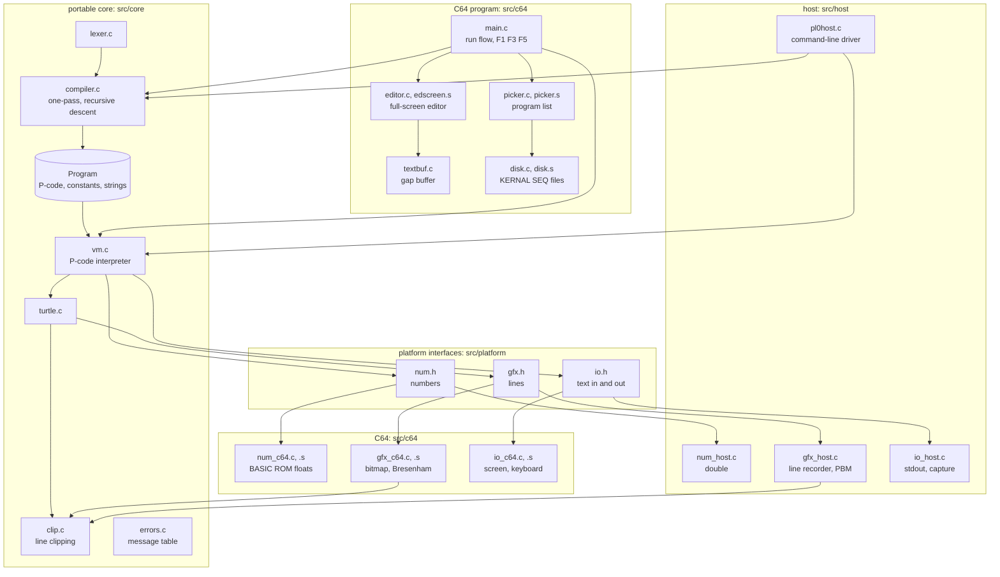
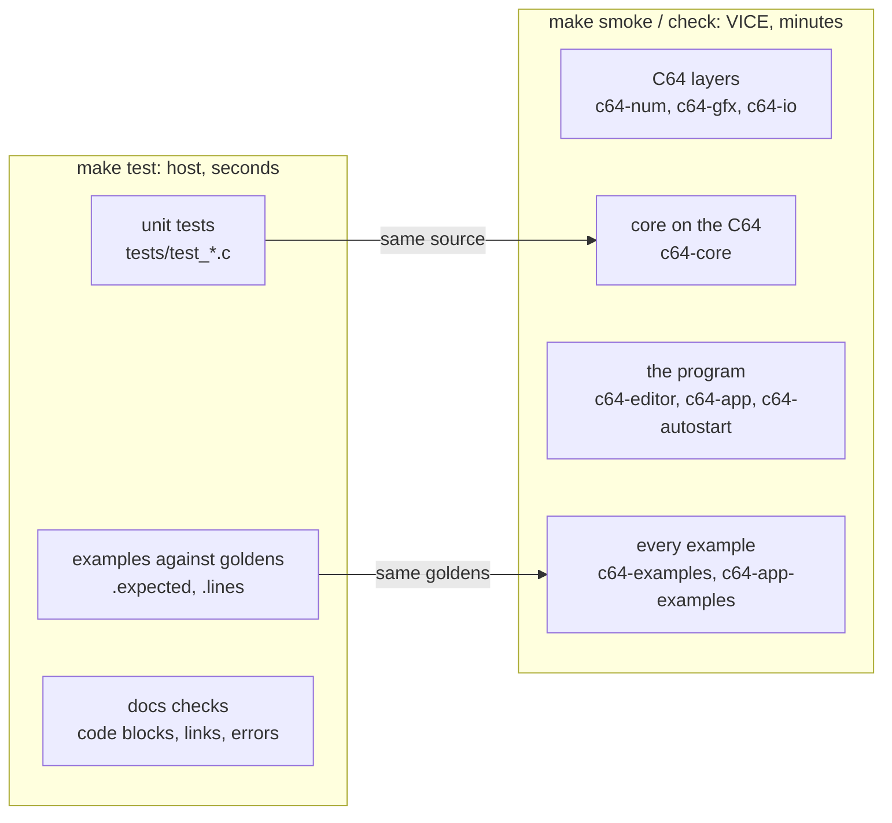
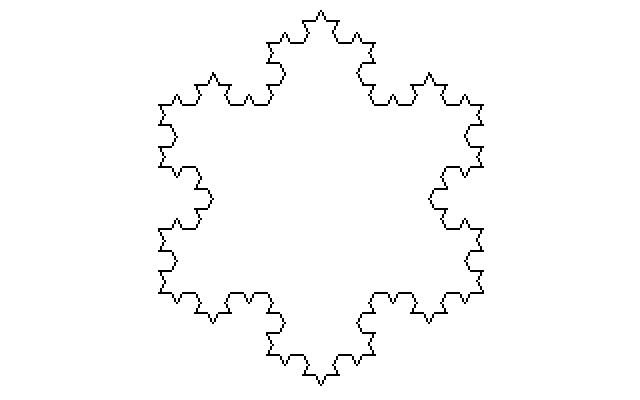
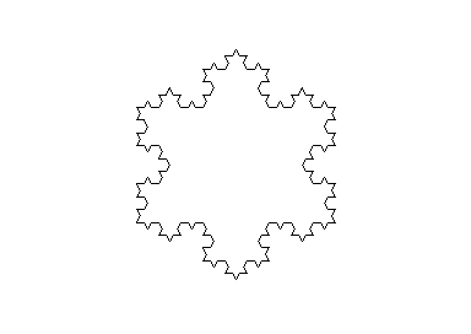

# Architecture overview

How the program is built, why it is built that way, and how it is tested.
This page is the map; the details are in the documents it links:

| Document | What it covers |
|---|---|
| [spike-results.md](spike-results.md) | the Task 1 experiments: BASIC ROM floats from cc65, the memory budget, the bitmap's place, the decision to keep the VM in C |
| [memory-map.md](memory-map.md) | the C64 memory map of the finished program (generated from the linker map and checked by `make c64-mem`), and how it got there |
| [editor.md](editor.md) | the editor, the run flow, the disk layer, the save prompt and the program list |
| [testing.md](testing.md) | every test layer and gate, how long each takes, how to install the tools |
| [examples-budget.md](examples-budget.md) | the size, instruction count and C64 run time of every example (generated) |
| [media.md](media.md) | how the screenshots, the demo GIF and the showcase site are made |

## The layers

(The two diagrams on this page are Mermaid source, which GitHub draws;
they were written and reviewed as text and have not been checked
rendered yet.)



- **The core** (`src/core`) is the same C source for both targets: the
  lexer, the compiler, the virtual machine (VM), the turtle, the line
  clipper and the error table. It knows nothing about the C64.
- **Three thin interfaces** (`src/platform`) are all the core needs from a
  machine: numbers (`num.h`: parse, format, arithmetic, functions,
  compare), lines (`gfx.h`: open, close, draw a clipped line) and text
  (`io.h`: print, read a number, "was RUN/STOP pressed?").
- **The host implementation** (`src/host`) uses C doubles, records lines
  instead of drawing them, and prints to stdout. With `pl0host.c` it is
  the command-line driver `build/pl0host` that the tests use.
- **The C64 implementation** (`src/c64`) uses the BASIC ROM's
  floating-point routines, the VIC-II bitmap and the text screen, and adds
  the parts only the C64 program has: the editor, the program list, the
  disk access and `main`. Each of these is C with the hot or bulky parts
  in 6502 assembly (`.s`).

| Source | Lines | Role |
|---|---:|---|
| `src/core/lexer.c` | 149 | tokens; keywords, names, numbers, strings, comments |
| `src/core/compiler.c` | 526 | one-pass recursive-descent compiler emitting P-code |
| `src/core/vm.c` | 248 | the P-code interpreter |
| `src/core/turtle.c`, `clip.c` | 227, 65 | turtle state and moves; Cohen-Sutherland clipping |
| `src/core/errors.c`, `limits.h`, `pcode.h` | 59, 16, 84 | messages, limits, the instruction set |
| `src/c64/num_c64.c`, `.s` | 167, 892 | numbers on the BASIC ROM; exact parse and format |
| `src/c64/gfx_c64.c`, `.s`, `io_c64.c`, `.s` | 83, 310, 86, 296 | bitmap and line drawing; text screen, number input, RUN/STOP |
| `src/c64/editor.c`, `edscreen.s`, `textbuf.c` | 624, 456, 192 | the editor |
| `src/c64/picker.c`, `.s`, `disk.c`, `.s` | 129, 316, 113, 373 | program list and disk |
| `src/c64/main.c` | 257 | start-up, run flow, save prompt |

## From text to a running program

1. **F1** hands the editor's text (`tb_text`, a NUL-terminated string in
   the 8 KB buffer at `$A000`) to `pl0_compile`.
2. **The compiler** reads tokens from the lexer and emits instructions in
   one pass, like Wirth's: there is no syntax tree. Forward jumps (`if`,
   `while`, the jump over procedure bodies) are patched when their target
   is known. Literals go to a constant pool, strings to a string area.
   All state is static and the first error unwinds with `longjmp`, which
   suits cc65 (statics are faster than its software stack, and there is
   no error check after every call).
3. **The VM** runs the instructions with a stack of numbers. It never
   allocates and checks the stack only when a frame is created.
4. **Output and drawing** go through `io.h` and `gfx.h`; the first turtle
   statement opens the bitmap.

### The P-code

Wirth's PL/0 machine has eight instructions; this one keeps them and adds
six. An instruction is 4 bytes: `op`, `lvl` (one byte) and `arg` (16
bits). All variable and constant offsets are byte offsets, already
multiplied by the 5-byte size of a C64 number, so the VM never multiplies
(`src/core/pcode.h`).

| Op | `lvl` | `arg` | Effect |
|---|---|---|---|
| `LIT` | | constant's byte offset | push a constant from the pool |
| `OPR` | sub-operation | source line | arithmetic, comparison or return (below) |
| `LOD` | declaration level | byte offset in that frame | push a variable (parameters have negative offsets) |
| `STO` | declaration level | byte offset | pop into a variable |
| `CAL` | line (low 8 bits) | callee's address (10 bits) and line (high 6 bits) | call a procedure |
| `INT` | the block's maximum temporaries | local bytes and the block's level | enter a block: reserve and clear its variables |
| `JMP` | | address | jump; a backward jump (a `while` loop) checks RUN/STOP |
| `JPC` | | address | pop; jump if zero (false) |
| `WRN` | | | pop and print a number |
| `WRS` | | string's byte offset | print a string |
| `WRL` | | | print a new line |
| `RED` | | source line | read a number and push it |
| `FN` | function | source line | replace the top by `sin`, `cos`, `atan`, `sqrt`, `abs`, `int`, `exp` or `log` of it |
| `TUR` | turtle operation | source line | `forward`, `turn`, `penup`, `pendown`, `home` or `moveto` |

`OPR` sub-operations, in Wirth's numbering: 0 return, 1 negate, 2 add,
3 subtract, 4 multiply, 5 divide, 6 odd, 8 =, 9 #, 10 <, 11 >=, 12 >,
13 <=. Instructions that can fail at runtime carry the source line in
`arg`, so a runtime error can name the line without a separate line
table; `CAL` packs its line next to the address.

### Frames and the display

```text
          stack grows upwards
   sp ->  | temporaries          |
          | local variables      |  bp + 3 cells and up, cleared by INT
          | RA  return address   |  bp + 2
          | DL  caller's bp      |  bp + 1
   bp ->  | SL  saved display    |  bp + 0
          | last parameter       |  bp - 1
          | ...                  |
          | first parameter      |  bp - n  (pushed by the caller, left to right)
```

A frame is 3 header cells, the parameters below them and the variables
above. Wirth's machine finds the variables of enclosing procedures by
following static links; this VM keeps a **display** instead, an array
`disp[level]` of frame pointers, one per declaration level (at most 5:
the main program and 4 nested levels). `INT` saves the old entry of its
level in the frame's SL cell and sets it; the return restores it. A
variable access is then one array lookup plus a fixed offset, which the
Task 1 spike measured as the fastest form on cc65.

`CAL` checks that the whole new frame fits (header, variables and the
block's maximum number of temporaries, which the compiler records in the
callee's `INT`) before it writes anything. So individual pushes need no
check, and a runaway recursion ends with `stack overflow (too deep)` at
the line of the call, without touching memory beyond the 512-cell stack.

## The C64 memory map

All numbers are from `build/c64/pl0.map` as generated in
[memory-map.md](memory-map.md) (cc65 2.19 from Ubuntu, `-O`).

```text
$0000-$03FF  zero page, CPU stack, KERNAL work area
             $033C-$03E9  LOWBSS: small variables in the cassette buffer (174 of 192 bytes)
$0400-$07E7  text screen (editor, program output)
$0801-$7490  BASIC stub, start-up code and CODE (27,729 bytes)
$7491-$7E6C  read-only data, data (2,524 bytes)
$7E6D-$97C2  BSS (6,486 bytes): the compiled Program (4,741), symbol table, ...
$97C3-$97FF  free: 61 bytes
$9800-$9FFF  C stack (2 KB, cc65's software stack)
$A000-$BFFF  the program text, 8 KB, in the RAM under the BASIC ROM
$C000-$CBFE  HIBSS (3,071 of 3,072 bytes): VM stack 2,560, editor 460, list 51
$CC00-$CFE7  colour matrix of the bitmap
$D000-$DFFF  I/O (VIC-II, SID, CIAs)
$E000-$FF3F  bitmap, 8,000 bytes, in the RAM under the KERNAL ROM
```

`build/pl0.prg` is 30,356 bytes. The BASIC ROM at `$A000` must stay
usable for floating point, and the KERNAL at `$E000` for the disk and the
keyboard, yet both 8 KB areas of RAM underneath are in use:

- The **program text** lives under the BASIC ROM. The C code runs with
  BASIC switched out (`$01 = $36`), and the float shims switch it in only
  for the duration of one ROM call. Nothing the ROM reads may lie there:
  the lexer copies every number into low RAM before parsing it.
- The **bitmap** lives under the KERNAL in VIC bank 3, with its colour
  matrix at `$CC00`. The VIC always reads RAM, so only the line routine's
  read-modify-write needs the KERNAL out, briefly, with interrupts off.
  The text screen at `$0400` is untouched by a drawing, so SPACE can
  switch between drawing and text by changing a few VIC registers.

### Where the bytes go

| Part | Code | Read-only + data | BSS | HIBSS | LOWBSS |
|---|---:|---:|---:|---:|---:|
| core: lexer, compiler, VM, turtle, clipper, errors | 12,813 | 845 | 1,598 | 2,560 | |
| numbers on the BASIC ROM | 2,396 | 9 | 86 | | |
| graphics | 663 | 8 | 18 | | |
| text I/O | 774 | 13 | 30 | | |
| editor (with the gap buffer) | 5,508 | 837 | | 460 | |
| disk | 1,200 | 111 | | | 69 |
| program list | 1,122 | 87 | | 51 | 27 |
| main: run flow, save prompt, the Program | 1,004 | 535 | 4,753 | | 78 |
| cc65 runtime and C library | 2,306 | 69 | 1 | | |
| **total** | **27,786** | **2,514** | **6,486** | **3,071** | **174** |

(Sums of the per-module rows of the generated table.)

### How it was made to fit

The spec allowed "about 38 KB" for everything; the first full build of
Task 15 overflowed the limit at `$97FF` by 988 bytes. Without dropping a
feature or a limit:

- The VM stack (2,560 bytes) moved to HIBSS, which the editor's variables
  also use; the textbuf functions the C64 does not call (about 950 bytes
  of code) are left out of the C64 build.
- The KERNAL disk calls and the parsing of the directory and `INDEX`
  moved to assembly (575 and 546 bytes, against about 1,100 and 750 in
  C).
- LOWBSS was created in the cassette buffer, which the program never uses.
- The program list reuses the memory of the compiled `Program`, which is
  idle while no program is compiled or run (a union in `main.c`).
- The 15 examples (about 8 KB) are files on the disk, not data in the
  program.

What is left: 61 bytes of low RAM, 18 in LOWBSS and 1 in HIBSS (115
before the final review's fixes: the reserved save names and the
disabled RESTORE).
`make c64-mem` fails if BSS passes `$97FF`, if HIBSS or LOWBSS overflow,
or if the tables in memory-map.md no longer match the map.

## Key decisions

| Decision | Why | Evidence |
|---|---|---|
| C with cc65, compiled to P-code, not assembly or a text-walking interpreter (one that walks the program text directly) | readable, mostly testable on a PC, close to Wirth's design; assembly would cost several times the effort, walking the text would be slow | spec section 4 |
| the VM stays in C | in real programs the ROM float routines dominate: an addition costs about 930 µs, a sine 27.5 ms, while tuned C dispatch costs about 505 µs per instruction against 210 µs in assembly; and one VM for both targets keeps the host tests valid for it | spike section 8 |
| floats from the BASIC ROM | the C64 already has a tested float library and maths functions; a separate one would take kilobytes | spike section 4 |
| ROM calls through shims with an error trap | a BASIC error (division by zero, overflow) would otherwise print `?OVERFLOW ERROR` and abandon the program; the shims point the error vector at a trap and return the error code | spike section 4, `num_c64.s` |
| exact number conversion, not the ROM's | the ROM's output routine prints pi (stored exactly as 3.14159265346) as `3.14159266` and 2^-20 as `9.53674317E-07`; its input routine reads `0.000099` several units of the last place low. `num_parse` and `num_format` convert exactly with a small bignum in assembly (2.4 KB with the ROM wrappers), so the C64 prints what the host prints for the same value | Task 11 report; `make c64-num` checks 174 random values and 104 literals against the host |
| ASCII inside, PETSCII only at the edges | cc65 turns C string literals into PETSCII for the C64, which made keywords, error texts and the number format disagree with the ASCII source text. Every C64 source is compiled through a wrapper that includes cc65's ASCII charmap, `src/core/ascii.h` stops a build without it, and assembly includes `ascii.inc`; screen codes and PETSCII exist only in keyboard, screen and disk code | spike-results "Text encoding", `Makefile` (`c64_cc`) |
| the program text under the BASIC ROM, the bitmap under the KERNAL | the only way to have 8 KB of text and an 8 KB bitmap next to 30 KB of program | spike sections 3 and 5 |
| examples on the disk, listed from an `INDEX` file | embedded, they did not fit; with `INDEX` the list shows descriptions without opening 15 files | spike section 7, editor.md |
| a gap buffer for the text, scanned in assembly | edits are cheap at the cursor; reading characters through the C accessor cost about 1,000 cycles each, the assembly scans about 40 | editor.md |
| one clipper for both targets | `clip.c` (Cohen-Sutherland, 32-bit arithmetic) is called by the host recorder and by the C64 line routine, so both draw the same pixels; the turtle first cuts very long lines in float arithmetic so that 16-bit pixel coordinates never saturate | `test_turtle.c` `clip_exact`, `make c64-gfx` |
| the turtle rounds to the nearest pixel and caches sine and cosine | the ROM's cos(0) is 0.99999999977, so truncation would lose a pixel; a sine costs 28 ms, so it is computed only when the direction changes | spike section 4 |
| work around two cc65 `-O` miscompiles | `x = c == K ? K2 : c` with stack locals read the wrong variable, and `(int16_t)i - n` with unsigned chars was computed in 8 bits, which made every procedure parameter read 0 on the C64 (the host was right). Both are rewritten, documented, and have reproducers | `tests/c64/cc65_bug_ternary.c`, `tests/c64/cc65_bug_sub.c`, spike-results section 9 |
| disk tests on an emulated 1541 with true drive emulation | the KERNAL and the drive's DOS behave as on hardware (directory, `FILE EXISTS`, read errors); saving with replace scratches and rewrites, because the 1541's `@0:` replace has a known bug | `make c64-disk`, `make c64-app` |

## Speed

Times on a PAL C64 in VICE, from F1 to the end of the program, through
the real program (`make c64-app-examples`; [examples-budget.md](examples-budget.md)).
The limit is 30 seconds.

| Example | C64 s | | Example | C64 s |
|---|---:|---|---|---:|
| KOCH | 26.17 | | SINE | 9.34 |
| PI | 24.39 | | SPIRAL | 5.44 |
| ROSE | 22.10 | | FACTORIAL | 3.28 |
| TREE | 22.10 | | STAR | 2.37 |
| LISSAJOUS | 14.51 | | GCD | 2.22 |
| PRIMES | 13.73 | | POLYGON | 1.98 |
| SIERPINSKI | 10.49 | | NEWTON | 1.45 |
| | | | SQUARE | 1.06 |

Most of the time goes to the ROM: about 28 ms for a sine, 53 ms for a
square root, 2 to 4 ms for an addition or multiplication through the
wrappers, about 20 ms to print a number. The drawings are bound by `turn`
(a sine and a cosine each) and by the maths functions; PI by the 500
rounds of its Leibniz loop, with two divisions each.

## Testing: host and target



- **On the host** (`make test`, about 10 seconds) the core is compiled
  with gcc against the host layers: 9,324 checks in 7 test programs
  (lexer, numbers, compiler and VM, errors, turtle and clipper, text
  buffer), every example against its golden output (text within 1e-6,
  drawings as an exact list of clipped lines), the example rules (size,
  line length, output that fits the screen, 40,000 instructions at
  most), the self-tests of the tools, and the documentation checks.
- **On the C64** (`make smoke`, about 4.5 minutes, in headless VICE) the
  same core is compiled by cc65 and runs on the emulated machine. The
  harness talks to VICE's remote monitor: it types keys, reads the
  screen memory and saves RAM snapshots, and Python tools compare them
  with the host's results. Text must match the host's golden output;
  drawings must match the host's rendering in pixel count (within 3%),
  bounding box (2 pixels) and shape (pixels far from the other picture,
  which rejects a mirrored or rotated figure). The program-level tests
  drive the real `pl0.prg` with keys, on a disk in an emulated 1541.
- `make check-full` adds every example twice on the C64, through a test
  driver and through the program, with its time.

The host tests are fast and catch almost everything in the core; the
target tests catch what only the C64 can show: the cc65 miscompiles, the
character encoding, the ROM's behaviour, memory, timing and the disk.
[testing.md](testing.md) lists every target.

### Host and C64 drawings

The host does not draw; it records the clipped lines (`pl0host --lines`)
and can render them as a picture (`--pbm`). Left, the host's rendering
of KOCH (`docs/img/host/`, made with `pl0host --pbm` and
`tools/pbm2png.py ... 2`); right, the C64's screen after the same
program, captured in VICE.

 

## Adding an example

An example is a file `examples/NAME.pl0` and a golden file next to it.

1. **Write it** within the rules that `tools/example_rules.py` enforces:
   a lower-case name of up to 12 characters; plain ASCII, at most 1,000
   bytes, lines of at most 38 characters; line 1 a comment with the
   description of at most 24 characters (the program list shows it),
   line 2 the start of a comment that explains the program. Text output
   must fit the screen (22 lines of 39 characters); a drawing must not
   touch the screen's edge.
2. **Make the golden:** `build/pl0host examples/NAME.pl0 > examples/NAME.expected`
   for text, or `build/pl0host --lines examples/NAME.lines examples/NAME.pl0`
   for a drawing, and check the result by eye (`--pbm` and
   `tools/pbm2png.py` for a drawing).
3. **Keep it fast:** under 40,000 executed P-code instructions
   (`pl0host --count-instr`), and under 30 s on the C64.
4. **Put it on the disk:** add the name to `ORDER` in `tools/mkdisk.py`;
   `make disk` refuses a disk whose examples and `ORDER` differ.
5. **Update the generated files:** `tests/run_examples.sh --write-budget`
   (examples-budget.md), `python3 tools/mksite.py --write` (the site's
   gallery), and the C64 times with `sh tests/c64_examples.sh --record`
   and `sh tests/c64_app_examples.sh --record` (then `--write-budget`
   again). `make media MEDIA=name` makes its screenshot.
6. **Document it** in the [user guide](../USER-GUIDE.md#the-examples) with
   a `pl0 example:NAME` block, which `make test` compares with the file.

`make test` checks the rules, the golden and the generated files;
`make check-full` runs it on the C64. There can be at most 15 examples
(`MAX_EXAMPLES` in `tests/run_examples.sh`).
